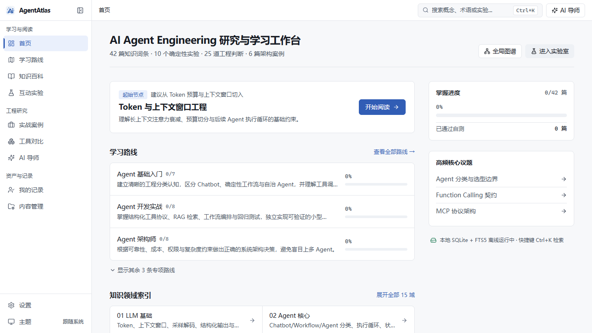
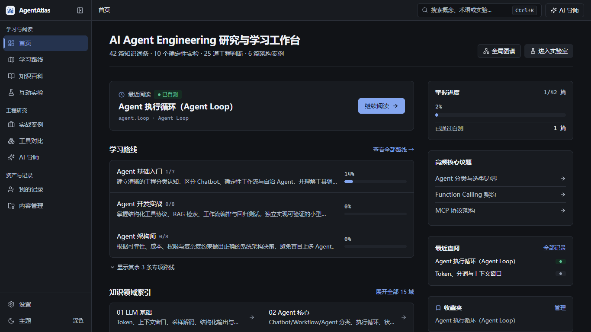
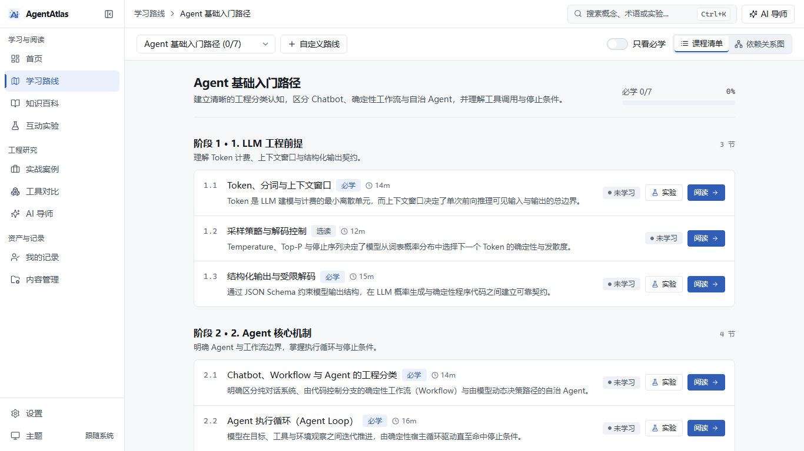
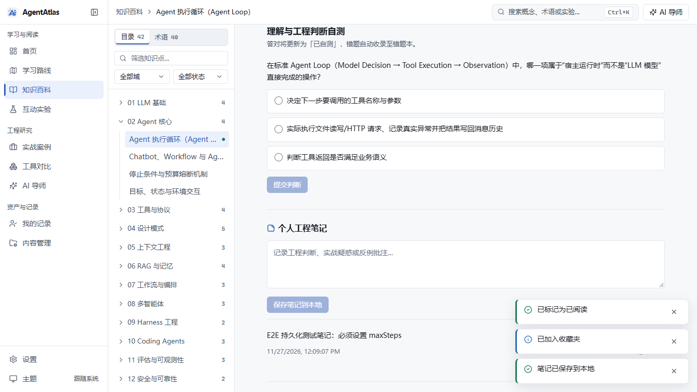
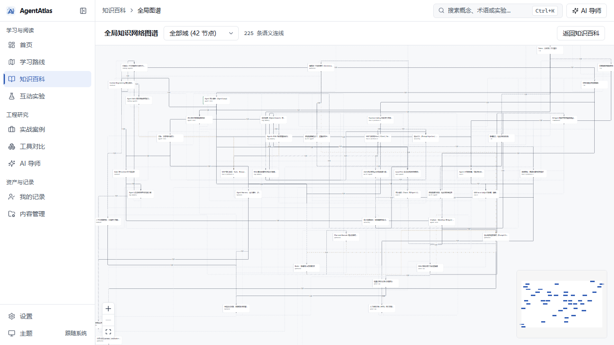
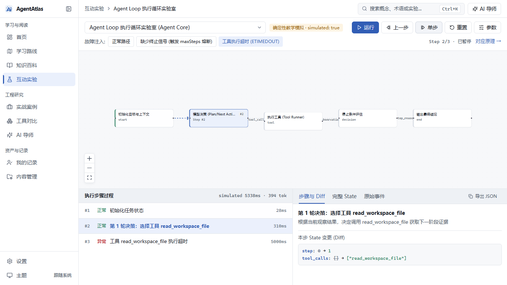

<div align="center">


# AgentAtlas

**本地优先的 AI Agent 工程学习、知识图谱与机制仿真工作台**

[](LICENSE)
[](https://nodejs.org/)
[](https://tauri.app/)
[](https://www.typescriptlang.org/)

**简体中文** | [English](README_EN.md)

</div>

---

AgentAtlas 是一款面向 AI Agent 工程师的本地优先（Local-first）桌面与 Web 工作台。它将系统化的 Agent 工程知识库、可交互依赖图谱、确定性机制仿真实验室、工程案例手册与学习进度管理整合在一个离线可用的工具中，无需云端账号或外部数据库即可运行。

## 核心特性

- **15 域系统知识库**：覆盖 LLM 基础、Agent 核心循环、工具与 MCP 协议、设计模式、上下文工程、RAG 与记忆、工作流编排、多 Agent 协作、运行沙箱、评测、安全等领域的结构化 Markdown 知识节点，支持 `[[wikilinks]]` 双向链接、反向引用与来源溯源。
- **全局与局部知识图谱**：基于 `@xyflow/react` 与 `elkjs` 自动布局，支持 DAG 前置依赖检测、1-2 跳局部图谱钻取以及 Mermaid 图表全屏预览。
- **10 个确定性仿真实验室**：内置基于 `Mulberry32` PRNG 的状态机仿真引擎，支持单步回放、参数调节、故障注入与检查点恢复，所有模拟指标均显式标注 `simulated: true`。
- **中英文全文检索**：基于 Node.js 内置 `node:sqlite` 与 FTS5，结合 `unicode61` 和 CJK 2/3-gram 分词以及术语同义词扩展，实现毫秒级本地搜索。
- **工程案例库与生态地图**：提供 6 套端到端生产级架构案例、主流框架/协议生态对比以及可自检的评估题库。
- **本地学习与开放内容管理**：学习笔记、书签、进度持久化保存在本地 SQLite；支持内容快照、原子导入、差异对比、一键回滚与 Obsidian 双向导入/导出。
- **可选 AI Tutor**：核心功能 100% 离线可用；按需接入 OpenAI 兼容接口时，API Key 仅保存在服务端内存或 Windows DPAPI 加密存储中，不写入数据库或备份文件。
- **环回安全边界**：本地 Fastify 服务仅监听 `127.0.0.1`，写接口强制校验 `Host`、`Origin` 与 `X-Atlas-Token`，Markdown 渲染全程启用 `rehype-sanitize`。

## 界面预览

<table>
  <tr>
    <td width="50%">
      
      <p align="center"><sub>工作台概览（浅色模式）</sub></p>
    </td>
    <td width="50%">
      
      <p align="center"><sub>工作台概览（深色模式）</sub></p>
    </td>
  </tr>
  <tr>
    <td width="50%">
      
      <p align="center"><sub>系统学习路线图</sub></p>
    </td>
    <td width="50%">
      
      <p align="center"><sub>知识库阅读器与双链视图</sub></p>
    </td>
  </tr>
  <tr>
    <td width="50%">
      
      <p align="center"><sub>全局知识图谱（ELK 自动布局）</sub></p>
    </td>
    <td width="50%">
      
      <p align="center"><sub>确定性机制仿真实验室</sub></p>
    </td>
  </tr>
</table>

## 快速开始

### 方式一：下载 Windows 绿色便携版（推荐）

前往 [GitHub Releases](https://github.com/rowanjove/AgentAtlas/releases) 下载 `AgentAtlas-win-x64-portable.zip`，解压后直接双击 `AgentAtlas.exe` 即可启动。便携版已内置 Tauri 2 桌面外壳、Node.js 24 运行时与完整知识库，无需额外配置环境。

### 方式二：从源码运行

**环境要求**

- Node.js `>= 24.0.0`（依赖内置 `node:sqlite`）
- pnpm `12.x`（推荐使用 `corepack enable`）
- 如需构建桌面便携版，需额外安装 Rust 工具链

**安装与启动**

```bash
git clone https://github.com/rowanjove/AgentAtlas.git
cd AgentAtlas
pnpm install
pnpm build
pnpm start
```

启动后在浏览器访问 `http://127.0.0.1:4317`（Windows 用户也可以直接运行根目录的 `start.ps1` 或 `start.bat`）。

## 常用命令

| 命令 | 说明 |
| :--- | :--- |
| `pnpm dev` | 启动本地 Fastify API 服务（开发模式） |
| `pnpm dev:web` | 启动 Vite 前端开发服务器 |
| `pnpm build` | 构建全部 workspace 包与前端静态资源 |
| `pnpm build:portable` | 打包 Windows x64 Tauri 2 绿色便携版 |
| `pnpm validate:content` | 校验知识库 Schema、双链、DAG 无环性与安全性 |
| `pnpm typecheck` | 全仓 TypeScript 类型检查 |
| `pnpm test` | 运行单元与集成测试（Vitest） |
| `pnpm test:e2e` | 运行端到端验收测试（Playwright） |
| `pnpm bench` | 运行本地检索与编译性能基准测试 |

## 项目结构

```text
AgentAtlas/
├── apps/
│   ├── server/        # Fastify 5 本地服务端、SQLite FTS5 索引、安全守卫与内容管理
│   └── web/           # React 19 + Vite + Tailwind v4 前端应用
├── packages/
│   ├── shared/        # 领域类型、Zod Schema、15 域分类与设计令牌
│   ├── content/       # Markdown/YAML 编译器、双链解析、DAG 校验与 Obsidian 互操作
│   └── simulator/     # Mulberry32 确定性仿真引擎（10 个机制实验室）
├── src-tauri/         # Tauri 2 原生桌面外壳与系统托盘集成
├── content/           # 开放格式知识节点、学习路径、评估题库、案例手册与术语表
├── docs/              # 设计系统与界面截图
├── scripts/           # 内容校验、性能基准与便携版打包脚本
└── tests/e2e/         # Playwright 端到端测试套件
```

更多架构细节与内容编写规范请参阅 [ARCHITECTURE.md](ARCHITECTURE.md) 和 [CONTENT_GUIDE.md](CONTENT_GUIDE.md)。

## 开源协议

本项目基于 [Apache License 2.0](LICENSE) 开源，第三方依赖归属声明见 [NOTICE](NOTICE)。
