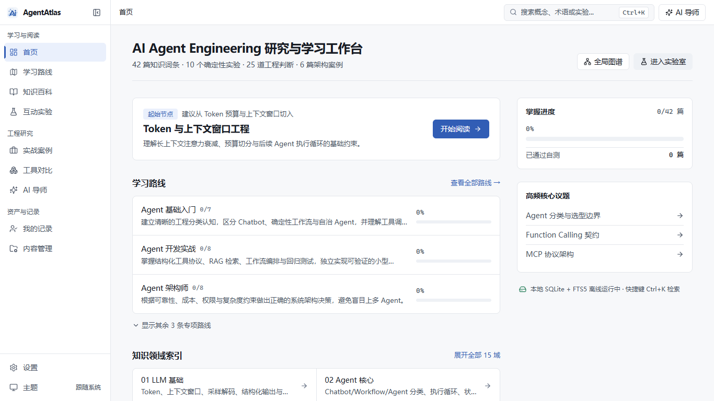
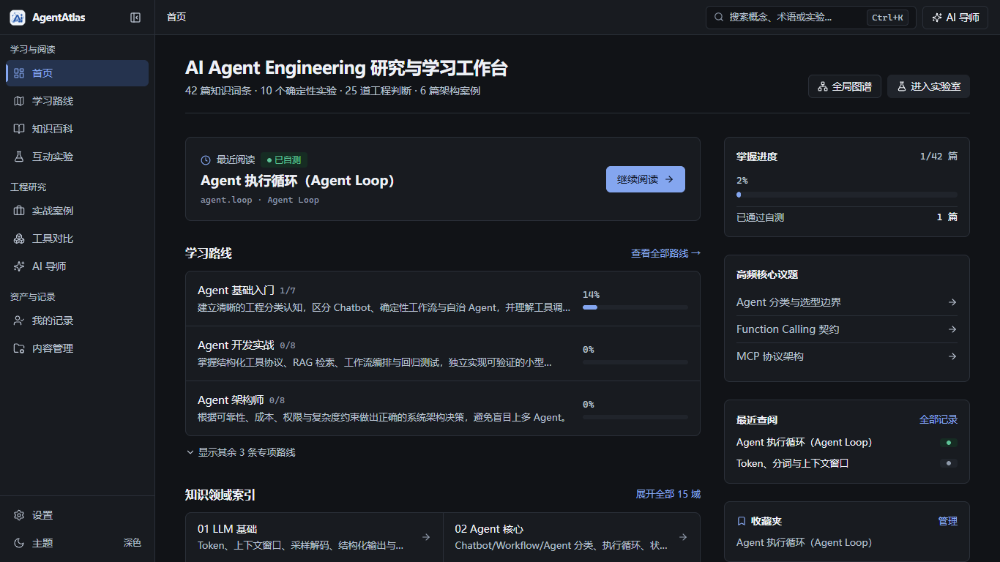
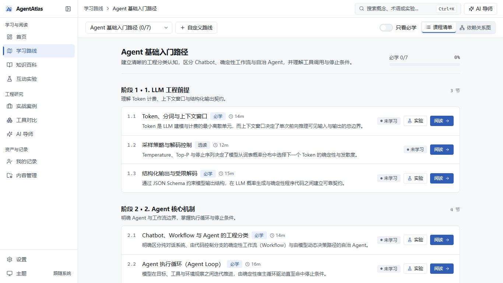
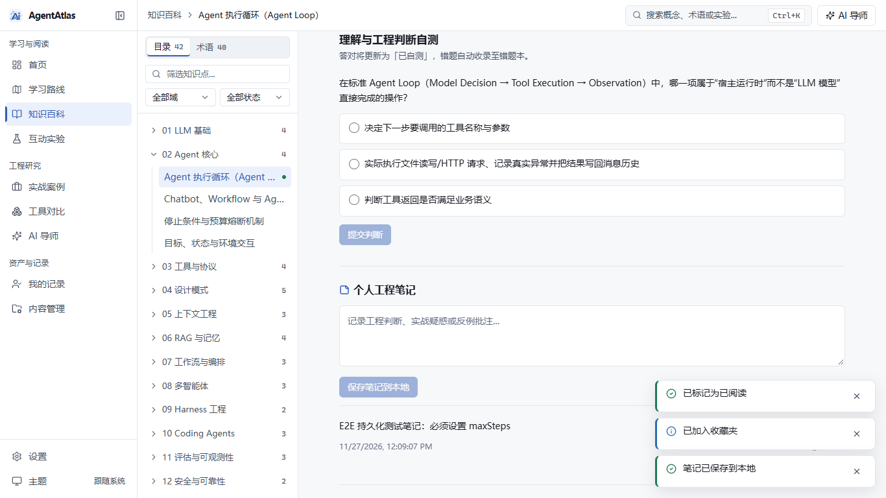
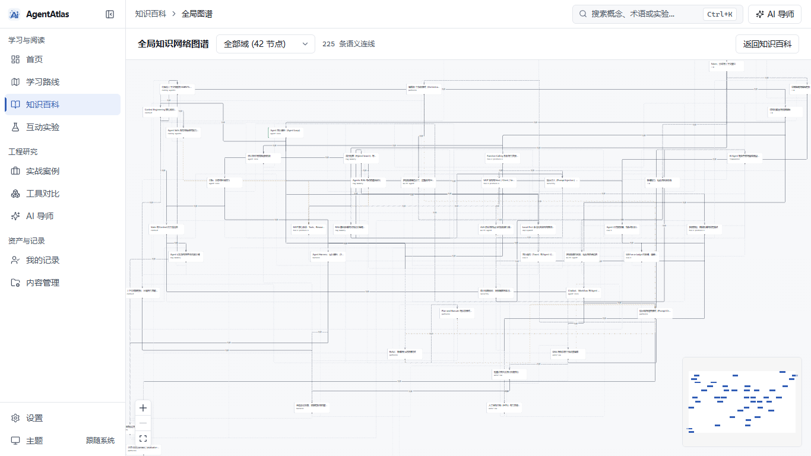
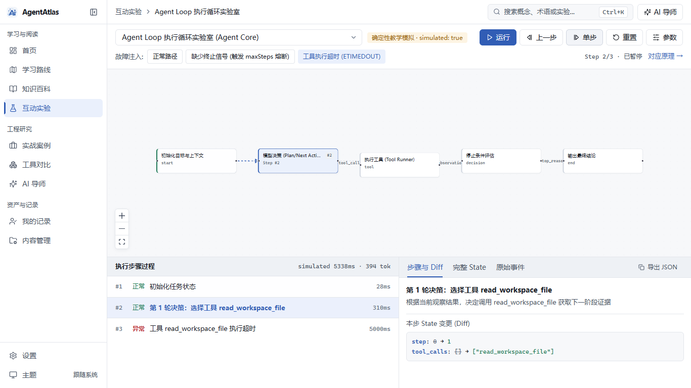

<div align="center">


# AgentAtlas

**Offline-Ready AI Agent Engineering Knowledge, Graph & Simulation Workbench**

[](LICENSE)
[](https://nodejs.org/)
[](https://tauri.app/)
[](https://www.typescriptlang.org/)

[简体中文](README.md) | **English**

</div>

---

AgentAtlas is an offline-ready desktop and web workbench for AI Agent engineering. It combines a structured knowledge base, interactive dependency graphs, deterministic mechanism simulation labs, production casebooks, and personal learning tools in a single offline-capable application — no cloud account or external database required.

## Key Features

- **15-Domain Knowledge Base**: Structured Markdown nodes covering LLM fundamentals, agent loops, tool calling & MCP, design patterns, context engineering, RAG & memory, workflow orchestration, multi-agent systems, runtime sandboxes, evaluation, and security — with `[[wikilinks]]`, backlinks, and verified source references.
- **Global & Local Knowledge Graphs**: Powered by `@xyflow/react` and `elkjs` layout with acyclic DAG dependency checks, 1–2 hop local graph exploration, and fullscreen Mermaid diagram rendering.
- **10 Deterministic Simulation Labs**: Seeded `Mulberry32` PRNG state-machine simulator supporting step-by-step replay, parameter tuning, fault injection, and checkpoint recovery. All simulated metrics are explicitly tagged `simulated: true`.
- **Fast CJK + English Full-Text Search**: Built on Node.js native `node:sqlite` and FTS5 with `unicode61`, CJK 2/3-gram indexing, and glossary synonym expansion.
- **Casebook, Ecosystem & Assessments**: Includes 6 end-to-end architecture case studies, a curated ecosystem map, and self-check assessments.
- **Durable Local State & Open Content**: Notes, bookmarks, and progress live in local SQLite (`user_*` tables). Supports pre-mutation snapshots, atomic content import, diffing, one-click rollback, and Obsidian import/export.
- **Optional AI Tutor**: Core workflows run 100% offline. When connected to an OpenAI-compatible endpoint, API keys stay in server memory or Windows DPAPI encrypted storage — never written to SQLite, logs, or backups.
- **Loopback Security Guard**: Fastify binds strictly to `127.0.0.1` with `Host`, `Origin`, and `X-Atlas-Token` verification on mutating routes, plus `rehype-sanitize` on all rendered Markdown.

## Screenshots

<table>
  <tr>
    <td width="50%">
      
      <p align="center"><sub>Workbench Overview (Light)</sub></p>
    </td>
    <td width="50%">
      
      <p align="center"><sub>Workbench Overview (Dark)</sub></p>
    </td>
  </tr>
  <tr>
    <td width="50%">
      
      <p align="center"><sub>Learning Roadmap</sub></p>
    </td>
    <td width="50%">
      
      <p align="center"><sub>Knowledge Reader & Backlinks</sub></p>
    </td>
  </tr>
  <tr>
    <td width="50%">
      
      <p align="center"><sub>Global Knowledge Graph (ELK Layout)</sub></p>
    </td>
    <td width="50%">
      
      <p align="center"><sub>Deterministic Simulation Lab</sub></p>
    </td>
  </tr>
</table>

## Quick Start

### Option 1: Download Windows Portable Build (Recommended)

Download `AgentAtlas-win-x64-portable.zip` from [GitHub Releases](https://github.com/rowanjove/AgentAtlas/releases), extract it, and launch `AgentAtlas.exe`. The portable archive bundles the Tauri 2 desktop shell, Node.js 24 runtime, and the full knowledge base with zero setup.

### Option 2: Run from Source

**Prerequisites**

- Node.js `>= 24.0.0` (uses built-in `node:sqlite`)
- pnpm `12.x` (`corepack enable` recommended)
- Rust toolchain (only required for building the Tauri 2 desktop shell)

**Install & Start**

```bash
git clone https://github.com/rowanjove/AgentAtlas.git
cd AgentAtlas
pnpm install
pnpm build
pnpm start
```

Open `http://127.0.0.1:4317` in your browser (on Windows, you can also run `start.ps1` or `start.bat`).

## Scripts

| Command | Description |
| :--- | :--- |
| `pnpm dev` | Start the local Fastify API server in dev mode |
| `pnpm dev:web` | Start the Vite frontend dev server |
| `pnpm build` | Build all workspace packages and web assets |
| `pnpm build:portable` | Build the self-contained Windows x64 Tauri 2 portable zip |
| `pnpm validate:content` | Validate content schemas, wikilinks, DAG acyclicity, and XSS safety |
| `pnpm typecheck` | Run TypeScript typechecking across all packages |
| `pnpm test` | Run unit and integration tests (Vitest) |
| `pnpm test:e2e` | Run Playwright end-to-end acceptance tests |
| `pnpm bench` | Run local search and compilation benchmarks |

## Project Structure

```text
AgentAtlas/
├── apps/
│   ├── server/        # Fastify 5 local server, SQLite FTS5 index, security guard, content manager
│   └── web/           # React 19 + Vite + Tailwind v4 frontend
├── packages/
│   ├── shared/        # Domain types, Zod schemas, 15-domain taxonomy, design tokens
│   ├── content/       # Markdown/YAML compiler, wikilink resolver, DAG checker, Obsidian interop
│   └── simulator/     # Seeded Mulberry32 simulation engine (10 interactive labs)
├── src-tauri/         # Tauri 2 native desktop shell & system tray integration
├── content/           # Open-format knowledge nodes, paths, assessments, casebook, glossary
├── docs/              # Design system & application screenshots
├── scripts/           # Content validator, benchmark, and portable build scripts
└── tests/e2e/         # Playwright E2E test suite
```

See [ARCHITECTURE.md](ARCHITECTURE.md) and [CONTENT_GUIDE.md](CONTENT_GUIDE.md) for architecture and authoring details.

## License

Licensed under the [Apache License 2.0](LICENSE). Third-party attributions are listed in [NOTICE](NOTICE).
