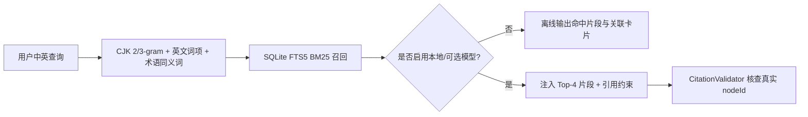

## 1. 业务目标与约束

构建可断网运行的桌面个人知识助手：输入中英文混合技术问题，返回有真实文档 ID 支撑的答案与片段高亮，目标响应 P95 ≤ 300ms，不能依赖云端向量数据库。

## 2. 备选架构对比与选型理由

- **方案 A（采用）：确定性混合索引 + 严格引用校验**。日常 85% 单跳查询直接通过 SQLite FTS5 (`unicode61` + CJK 2/3-gram + 术语同义词展开) 在毫秒级返回高置信片段；若配置了本地模型，仅把 Top-4 片段注入上下文并强制 CitationValidator 核对。
- **方案 B（否决）：全量文档注入长上下文**。知识库达到 1,000 篇后远超本地窗口与内存预算，且 Context Rot 严重。
- **方案 C（否决）：无条件 Agentic Multi-Hop**。简单术语查询无需 3 轮模型改写，徒增延迟。

## 3. 数据流与控制流

## 4. 失败模式与防护

- **未命中核心词导致模型自由发挥**：在上下文片段不足时显式提示证据不足，禁止无引用编造。
- **外部文本间接注入**：导入阶段过滤 `<script>` 与可执行 HTML，提示模板明确区分“检索参考资料”与“系统指令”。
