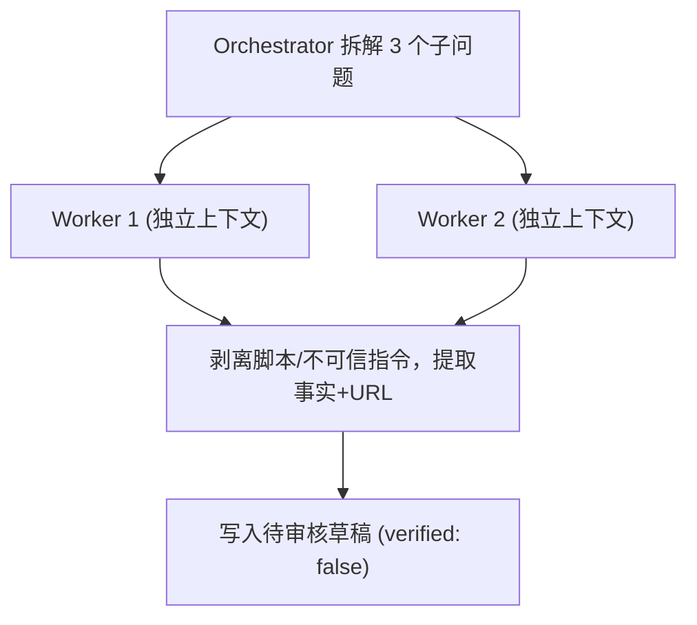

## 1. 业务目标与约束

针对一个开放研究主题，自动检索多篇官方文档与论文，对比技术差异并生成带真实 URL 与核实日期的研究简报；单次任务需控制总预算且防止恶意网页劫持 Agent。

## 2. 为什么选择 Orchestrator-Workers

网页研究面临**事先不知道要查几层链接、每个页面正文都很长**的双重特点。每个 Worker 拥有独立干净的上下文窗口：只负责抓一个主题、提取带有原始 URL 锚点的结构化要点并丢弃原始页面噪声，从而保护主 Orchestrator 的推理注意力。

## 3. 数据流与失败模式

- **失败模式**：Worker 总结时丢失版本前提（如把某 beta API 当成稳定特性）。**缓解**：提取 Schema 强制包含 `upstreamVersion` 与 `verifiedAt` 字段。
