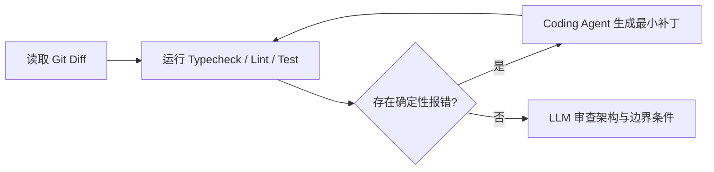

## 1. 业务目标与约束

在 Pull Request 或本地重构阶段自动定位缺陷、生成最小补丁并通过回归测试，同时严禁修改无关文件或越权访问敏感配置。

## 2. 架构决策

1. **先确定性工具，后模型推理**：由 Harness 先运行 `tsc --noEmit`、`eslint` 与现有单测，把精准报错行号喂给模型。
2. **AGENTS.md + 渐进式上下文**：只暴露目录树与相关文件片段，不把整个 `node_modules` 或无关历史塞入上下文。
3. **验证闭环**：补丁写入后必须重跑受影响测试集才允许进入最终审查结论。

## 3. 流程概览

