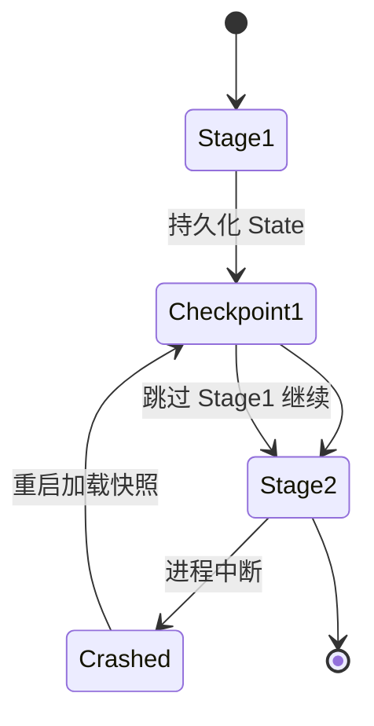

## 1. 工程背景

批量迁移几十个模块或执行多阶段数据清洗时，单次任务可能跨越多个上下文生命周期与多次进程重启。

## 2. 关键机制

- **状态外部化**：当前阶段、已完成 ID 列表、重试计数全部持久化到 SQLite，重启时直接从最后成功 Checkpoint 续跑。
- **幂等写入**：对外写接口携带 `taskId + stageId` 幂等键，防止崩溃恢复重放时重复写入。

