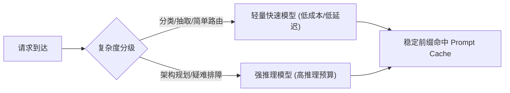

## 一句话定义

**推理成本与延迟工程** 是在满足任务准确率的前提下，对每轮模型调用的上下文长度、思考步数（Reasoning Tokens）、首字延迟（TTFT）和模型规格做系统性预算治理。

## 产生背景与需要解决的问题

普通聊天机器人一问一答只调用一次模型；而 Agent Loop 与 Multi-Agent 会把单次任务放大为 5–30 轮连续调用，且每一轮都在重传不断膨胀的上下文历史。如果不对模型规格与推理深度分级，延迟会迅速不可接受，成本呈二次方级放大。

## 第一性原理

1. **多轮上下文累乘**：若循环 $k$ 轮且每轮平均新增 $d$ tokens，总输入 Token 约为 $k \cdot C_0 + \frac{k(k-1)}{2} d$。
2. **Prefix Caching（前缀缓存）**：保持 System Prompt 与工具定义前缀完全稳定不变，可大幅降低重复计算成本与 TTFT。
3. **推理型模型（Reasoning Models）**：把“测试时计算（Test-time Compute）”转为隐藏思考 Token，能提升复杂规划与代码排障准确率，但输出计费与等待时间显著上升。

## 核心运行机制



## 最小可行实现

> 说明：以下为纯估算计算函数（演示多轮上下文累计输入开销趋势，单价请以实际服务商为准）。

```ts
export function estimateLoopInputTokens(
  baseSystemTokens: number,
  perTurnAddition: number,
  turns: number,
): number {
  let total = 0;
  for (let i = 0; i < turns; i++) {
    total += baseSystemTokens + i * perTurnAddition;
  }
  return total;
}
```

## 实际应用场景

- **双模型协作**：强模型负责任务分解与最终评审（Plan / Review），轻量模型执行具体文件检索与机械改动。
- **预算熔断**：为单次会话设置 `maxBudgetTokens` 与步数上限。

## 反例与常见误区

- **反例**：为了给固定模板做简单分类，启用高推理模式思考 15 秒再输出一个单词标签。
- **误区**：在 System Prompt 头部每轮动态插入当前时间戳或乱序工具清单，彻底击穿 Prompt Cache 命中率。

## 工程权衡

- **准确率 vs 延迟 vs 成本**：先用离线 Evals 测量轻量模型加上良好检索与明确步骤拆解后的实际得分，若已达标则不必升级昂贵模型。

## 关联知识

- 前置：[[llm.tokens-context]] · 延伸：[[multi-agent.cost-boundaries]]、[[deployment.local-offline-ops]]

## 事实分级与参考来源

- **已验证事实**：多轮代理循环重复发送不断增长的历史记录会显著放大输入 Token 消耗（Anthropic Effective Agents）。
- **工程经验**：将静态指令与工具定义放在提示最前端以保持前缀稳定性，能提升缓存复用率。
