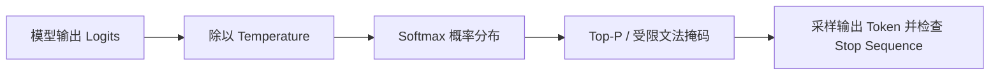

## 一句话定义

**采样与解码控制（Sampling & Decoding）** 是推理引擎根据模型输出的下一个 Token 概率分布，通过 Temperature、Top-P、Stop Sequences 等参数将其转换为最终离散文本序列的策略层。

## 产生背景与需要解决的问题

自回归语言模型在每一步输出的是整个词表上的概率分布（logits），而非单一答案。如果总是盲目高随机采样，JSON 结构、工具参数名和代码语法极易出错；如果全场景完全贪心（greedy），则在多路径探索与 Pass@k 测试中缺乏多样性。

## 第一性原理

- **Temperature ($T$)** 缩放 softmax 前的 logits：$p_i \propto \exp(z_i / T)$。$T \to 0$ 逼近最大概率贪心选择；$T > 1$ 拉平概率分布，增加长尾词出现几率。
- **Top-P (Nucleus Sampling)** 只在累计概率达到 $P$ 的最小候选集内采样，过滤极低概率噪声。

## 核心运行机制



## 最小可行实现

> 说明：以下 JSON 请求体适用于 OpenAI-compatible Chat Completions 接口（截至 2026-11-26 标准参数）。

```json
{
  "model": "local-model",
  "temperature": 0.1,
  "top_p": 0.9,
  "max_tokens": 800,
  "stop": ["</tool_call>"]
}
```

## 实际应用场景

- **工具调用与结构化抽取**：`temperature` 设 `0.0–0.2`，降低字段名拼写与枚举值漂移。
- **Evals 基准对比**：固定较低 `temperature`（及可选 `seed`，视模型引擎支持情况）降低实验方差。

## 反例与常见误区

- **误区**：即使设 `temperature: 0`，分布式 GPU 浮点归约非确定性仍可能导致极少数边界 Token 出现微小差异，因此生产仍需 [[tools.schema-validation]]。

## 工程权衡

- **确定性 vs 探索性**：代码修复的 Pass@1 回归测试优先低温度；多方案头脑风暴或 Pass@k 候选生成可适度提高温度。

## 关联知识

- 前置：[[llm.tokens-context]] · 延伸：[[llm.structured-output]]、[[evals.datasets-metrics]]

## 事实分级与参考来源

- **已验证事实**：低温度收缩分布尾部概率，提高输出集中度（OpenAI API 文档）。
- **工程经验**：工具调用节点建议 `temperature <= 0.2`，不要同时剧烈调整 `temperature` 和 `top_p`。
