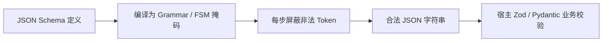

## 一句话定义

**结构化输出（Structured Output）** 是要求模型严格按照预定义 JSON Schema 生成可被代码直接反序列化的数据对象，而不是自由格式的自然语言文本。

## 产生背景与需要解决的问题

在早期工程中，开发者只能用正则从 Markdown 文本里“抠 JSON”，经常遇到缺失引号、多余解释文本或枚举值拼错的问题。Agent 要驱动工具、路由分支和持久化状态，必须让模型输出遵守严格的数据契约。

## 第一性原理

在支持受限解码（Constrained Decoding / Grammar-guided Generation）的推理后端中，解码器会在每一步将 JSON Schema 编译成有限状态机，对非法语法 Token 直接把 logit 置为 $-\infty$（屏蔽采样），从而在**语法层保证 100% 合法 JSON 结构**。但**语义正确性**（例如给出的文件路径是否真实存在）仍需宿主逻辑验证。

## 核心运行机制



## 最小可行实现

> 说明：以下为 TypeScript + Zod 演示代码（依赖 `zod@^3`，无需联网），展示程序边界的二次防御性校验。

```ts
import { z } from 'zod';

export const RouteDecisionSchema = z.object({
  intent: z.enum(['billing', 'technical', 'security']),
  confidence: z.number().min(0).max(1),
  reason: z.string().min(5),
});

export function parseModelDecision(rawJson: string) {
  const parsed = JSON.parse(rawJson);
  return RouteDecisionSchema.parse(parsed);
}
```

## 实际应用场景

- 意图路由器（Routing）输出分类标签与置信度。
- 数据抽取流水线提取实体、日期和引用编号。
- 评估裁判输出结构化打分理由。

## 反例与常见误区

- **反例**：在 Schema 中放入过多深度嵌套或递归联合类型，导致部分本地推理引擎编译 Grammar 超时或显著变慢。
- **误区**：以为语法合法的 JSON 就等于业务数据真实可信，忽略数值范围与业务引用核查。

## 工程权衡

- **强约束 vs 推理表达力**：直接强迫复杂推理一步输出极简 JSON 可能会挤压模型思维空间；常见解法是允许 Schema 中包含先写的 `reasoning` 字段，再写最终 `decision` 字段。

## 关联知识

- 前置：[[llm.tokens-context]] · 延伸：[[tools.function-calling]]、[[tools.schema-validation]]

## 事实分级与参考来源

- **已验证事实**：受限解码能保证输出符合指定 JSON Schema 语法子集（OpenAI Structured Outputs 文档）。
- **工程经验**：把 `reasoning` 字段置于决策字段之前，有助于模型在自回归生成中先整理依据再下结论。
