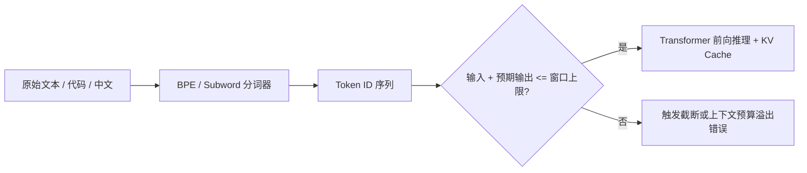

## 一句话定义

**Token（词元）** 是大模型通过子词分词器（如 BPE）将原始文本切分后的最小计算单元；**上下文窗口（Context Window）** 是模型单次推理同时容纳输入提示、工具返回与生成输出的总 Token 容量上限。

## 产生背景与需要解决的问题

自然语言词汇表规模极大且跨语种形态差异显著。如果按字符建模，序列过长且语义稀疏；如果按整词建模，未登录词（OOV）与代码标识符会爆炸。子词分词（BPE/SentencePiece）在词表大小与序列长度之间取得工程平衡。同时，Transformer 自注意力机制的计算与 KV Cache 内存开销随序列长度显著增长，因此模型必须限定单次推理的上下文窗口上限。

## 第一性原理

1. **注意力成本约束**：标准自注意力对长度 $n$ 的上下文存在 $O(n^2)$ 交互复杂度及线性增长的 KV Cache 显存占用。
2. **有效上下文小于标称窗口**：即使模型标称支持 128K–1M Token，噪声信息越多，模型在长距离约束上的检索与遵循准确率越容易下降（[[context.engineering-principles|Context Rot]]）。

## 核心运行机制



## 最小可行实现

> 说明：以下为纯离线教学估算示例（非特定厂商精确 BPE Tokenizer），用于演示中文与英文在预算估算上的差异。

```ts
// 启发式 Token 估算示例（教学演示用；精确计数应使用目标模型官方 tokenizer）
export function estimateTokensRough(text: string): number {
  const cjkChars = (text.match(/[\u4e00-\u9fff]/g) || []).length;
  const nonCjkChars = text.length - cjkChars;
  return Math.ceil(cjkChars * 1.5 + nonCjkChars / 4);
}
```

## 实际应用场景

- 为多轮 Agent 循环设置安全的 `max_tokens` 与历史裁剪阈值（参见 [[context.budget-compaction]]）。
- 估算中文文档与英文代码混合场景下的 API 成本和缓存命中收益。

## 反例与常见误区

- **误区 1：1 个汉字 = 1 个 Token**。实际上主流 BPE 词表中不少汉字会拆成 1.5–2+ Token，中文上下文消耗常高于直觉。
- **误区 2：把 128K 窗口当免费硬盘用**。塞满无关文件会拖慢首字延迟（TTFT）并稀释核心指令注意力。

## 技术边界与工程权衡

- **权衡**：更精细的分词统计 vs 零依赖启发式估算。本地离线系统可在无目标模型 tokenizer 时使用启发式预算预留 20% 安全余量，并在命中服务端 API 返回 `usage` 时校准。

## 关联知识

- 延伸阅读：[[context.engineering-principles]]、[[context.budget-compaction]]、[[llm.reasoning-cost]]

## 事实分级与参考来源

- **已验证事实**：Transformer 上下文受窗口上限与注意力稀释影响，KV Cache 随序列增长（来源：Anthropic Context Engineering）。
- **工程经验**：在生产 Agent 中将单轮有效工作上下文控制在高信噪比区间，比塞满标称上限更稳定。
