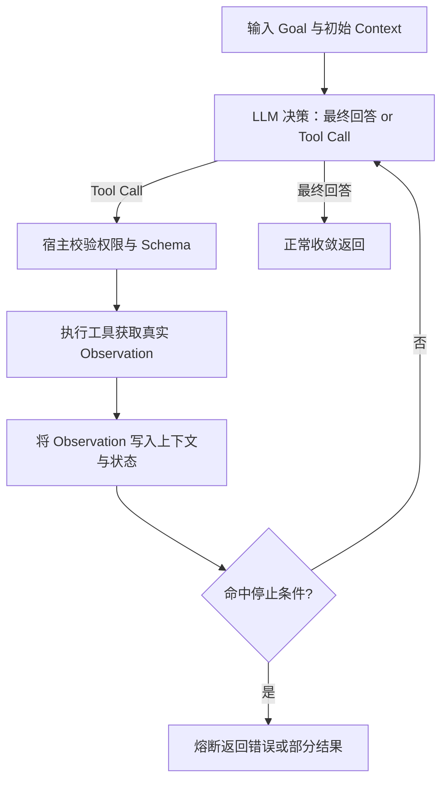

## 一句话定义

**Agent 执行循环（Agent Loop）** 是由宿主程序维护的 `while` 控制循环：每轮把当前目标、历史与观测交给模型，若模型返回工具调用意图则由宿主执行并回填结果，直到模型给出最终答复或触发熔断停止条件。

## 产生背景与需要解决的问题

单次 LLM 调用无法感知工具执行后的真实世界反馈（例如文件不存在、命令报错、检索无结果）。Agent Loop 通过持续闭环，使系统能够依据真实反馈调整后续动作、修复失败参数并逐步收敛到目标。

## 第一性原理

Agent Loop 本质上是一个**受控部分可观测马尔可夫决策过程（POMDP）的工程近似**：
- 模型 = 策略函数 $\pi(\text{action} \mid \text{context})$
- 宿主运行时 = 环境适配器（执行动作、采集观测、维护硬状态、执行熔断）

## 核心运行机制



## 最小可行实现

> 说明：以下为教学最小闭环伪代码（TypeScript，零外部依赖），可直接对照 Playground `agent-loop` 实验理解。

```ts
export async function runMiniLoop(
  goal: string,
  maxSteps: number,
  decide: (history: string[]) => Promise<{ type: 'tool'; name: string; arg: string } | { type: 'final'; text: string }>,
  execTool: (name: string, arg: string) => Promise<string>,
) {
  const history = [`GOAL: ${goal}`];
  for (let step = 1; step <= maxSteps; step++) {
    const decision = await decide(history);
    if (decision.type === 'final') {
      return { status: 'completed', step, output: decision.text };
    }
    const observation = await execTool(decision.name, decision.arg);
    history.push(`STEP ${step} TOOL ${decision.name} -> ${observation}`);
  }
  return { status: 'max_steps_reached', step: maxSteps, output: null };
}
```

## 实际应用场景

- 仓库代码检索与单测修复闭环。
- 多步调研助手：检索 → 发现缺失关键字 → 改写查询再检索 → 综合总结。

## 反例与常见误区

- **反例**：不设 `maxSteps` 或连续失败计数，导致模型在报错工具上死循环烧光预算。
- **误区**：把所有中间工具输出的几万行日志原文原封不动追加到 `history`，几轮之后直接撑爆窗口。

## 工程权衡

- **自主步数 vs 成本与可预测性**：步数预算给得太小，复杂任务做不完；给得太大且无停滞检测（Stall Detection），则会放大失控开销。推荐配合 [[agent.stop-conditions]] 治理。

## 关联知识

- 前置：[[agent.taxonomy]] · 延伸：[[agent.state-environment]]、[[agent.stop-conditions]]、[[tools.function-calling]]

## 事实分级与参考来源

- **已验证事实**：Thought/Action/Observation 循环是现代工具型 Agent 的标准运行原语（Hugging Face Agents Course；Anthropic Effective Agents）。
- **工程经验**：在生产循环中记录每步 `stop_reason` 与工具耗时对排障至关重要。
