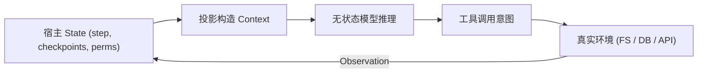

## 一句话定义

**环境（Environment）** 是 Agent 外部所有可观测和可修改的世界（文件系统、数据库、API、浏览器）；**状态（State）** 是系统对当前任务进展与约束的结构化记录。

## 产生背景与需要解决的问题

大模型每次推理本质上是无状态函数 $f(\text{messages}) \to \text{completion}$。要让智能体完成多步现实任务，宿主系统必须负责维护状态并在每次执行工具后把真实环境变化同步回来。

## 第一性原理

1. **部分可观测性**：模型永远看不到完整外部世界，只能通过工具返回的 Observation 窥见局部切片。
2. **环境副作用不可自动回滚**：LLM 生成一段文本可以丢弃重来，但工具执行过的删库、发邮件或覆盖文件一旦发生就改变了真实环境。

## 核心运行机制



## 最小可行实现

```ts
export interface AgentRuntimeState {
  taskId: string;
  step: number;
  maxSteps: number;
  completedTargets: string[];
  pendingApproval: boolean;
}
```

## 实际应用场景

- 在浏览器或代码仓库场景中，明确区分“只读探测工具”和“产生环境副作用工具”。

## 反例与常见误区

- **误区**：认为环境每次执行工具都会返回干净准确的结果；实际上工具可能超时、返回截断文本或被外部恶意内容污染。

## 工程权衡

- **即时反馈 vs 隔离沙箱**：对破坏性环境操作应先在临时工作区/Git 分支或 dry-run 预览中验证，再提交到主环境。

## 关联知识

- 前置：[[agent.loop]] · 延伸：[[context.state-vs-context]]、[[harness.runtime-sandbox]]

## 事实分级与参考来源

- **已验证事实**：LLM 推理本身是无状态的，跨轮持久状态与环境交互均由外围运行时承载（LangGraph 文档；HF Agents Course）。
