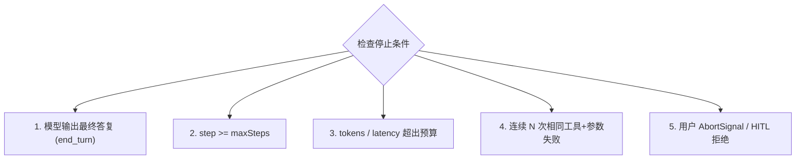

## 一句话定义

**停止条件（Stop Conditions）** 是宿主运行时强制终止 Agent Loop 的显式规则集合，确保系统在任务完成、预算耗尽、出现死循环或用户取消时可靠退出。

## 产生背景与需要解决的问题

概率模型在工具连续失败或遇到矛盾条件时，往往倾向于“再试一次”，如果没有确定性的外部停止器，Agent 会在几分钟内消耗巨额费用或锁死工作线程。

## 第一性原理

停止判断必须由**宿主确定性逻辑**与**模型语义信号**共同组成：模型有权表达“我认为任务结束了（`end_turn`）”，但只有宿主有权强制执行“步数/预算/错误次数已超限”。

## 核心运行机制



## 最小可行实现

```ts
export type StopReason =
  | 'completed'
  | 'max_steps'
  | 'token_budget_exceeded'
  | 'repeated_tool_failure'
  | 'user_cancelled';

export function checkStopCondition(ctx: {
  step: number;
  maxSteps: number;
  tokensUsed: number;
  tokenBudget: number;
  consecutiveSameFailures: number;
  aborted: boolean;
}): StopReason | null {
  if (ctx.aborted) return 'user_cancelled';
  if (ctx.step >= ctx.maxSteps) return 'max_steps';
  if (ctx.tokensUsed >= ctx.tokenBudget) return 'token_budget_exceeded';
  if (ctx.consecutiveSameFailures >= 3) return 'repeated_tool_failure';
  return null;
}
```

## 实际应用场景

- 为每类 Agent 区分可观测的 `stop_reason`，在评估和告警中统计“因预算截断”的比例。

## 反例与常见误区

- **反例**：仅依赖系统提示词里写“最多调用 5 次工具”，而不写程序计数器。模型经常记错自己调了几次。

## 工程权衡

- **提前熔断 vs 允许恢复**：命中 `max_steps` 时不要直接丢弃已收集证据，应汇总当前已知状态与未决阻塞交还人类或规划层。

## 关联知识

- 前置：[[agent.loop]] · 延伸：[[harness.budget-recovery]]、[[llm.reasoning-cost]]

## 事实分级与参考来源

- **已验证事实**：设置最大迭代次数与明确停止条件是构建可控 Agent 的基本原则（Anthropic Effective Agents）。
