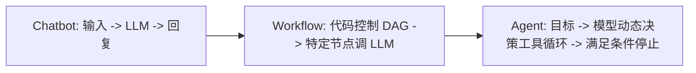

## 一句话定义

在 AI 工程中，**Chatbot** 是单轮或多轮被动问答；**Workflow（工作流）** 是通过确定性代码编排 LLM 与工具的固定路径；**Agent（智能体）** 是由 LLM 在运行时动态决定工具选择、循环次数与终止时机的自治系统。

## 产生背景与需要解决的问题

业界常把任何“接入了 LLM 的脚本”都称作 Agent，导致团队在简单确定性场景里过度引入不可控的自治循环，增加延迟、调试难度与安全风险。建立清晰的谱系边界是正确架构选型的第一步。

## 第一性原理

核心区分标准在于**控制流（Control Flow）的决策权归属**：
- 控制流 100% 由程序代码（`if/for/DAG`）决定 → **Workflow**。
- 控制流由模型根据环境实时观察动态决定下一步 → **Autonomous Agent**。

## 核心运行机制



## 最小可行实现

> 说明：以下对比伪代码直观展示 Workflow 与 Agent 控制权差异（TypeScript 教学示意）。

```ts
// 确定性 Workflow：步骤与分支完全可预测
async function summaryWorkflow(doc: string, llm: (p: string) => Promise<string>) {
  const outline = await llm(`提取大纲: ${doc}`);
  const risks = await llm(`检查风险: ${outline}`);
  return { outline, risks };
}

// 自治 Agent：由模型决定何时继续调工具、何时结束
async function miniAgent(goal: string, maxSteps = 4, stepFn: (s: number) => Promise<{ done: boolean }>) {
  for (let i = 0; i < maxSteps; i++) {
    const res = await stepFn(i);
    if (res.done) break;
  }
}
```

## 实际应用场景

- **选用 Chatbot**：知识问答、文案润色、单次代码解释。
- **选用 Workflow**：固定步骤审批流、多源日报生成、结构化 ETL 提取。
- **选用 Agent**：未知深度的代码 Bug 排查、开放式跨文档研究、动态环境排障。

## 反例与常见误区

- **反例**：用自治 Agent 去处理“每天 8 点查 3 张固定表发邮件”的任务，把 100% 确定性变成概率事件。
- **误区**：认为 Workflow 不够“智能”；实际上生产中大部分高可靠 AI 系统本质上是强约束 Workflow 包裹局部 Agent 节点。

## 工程权衡

- **可控性与成本 vs 灵活性**：Workflow 易测试、可审计、成本低；Agent 能适应未知边界条件，但必须搭配沙箱、预算限制与 Evals 门禁。

## 关联知识

- 前置：[[llm.structured-output]] · 延伸：[[agent.loop]]、[[workflow.dag-state-machine]]

## 事实分级与参考来源

- **已验证事实**：Anthropic《Building effective agents》明确将系统划分为 Workflows 与 Agents，并建议优先选择可满足需求的最简单方案。
- **争议观点**：部分框架将所有状态图节点统一称作 Agent，工程评审时应以“控制流是否动态由模型决定”为准。
