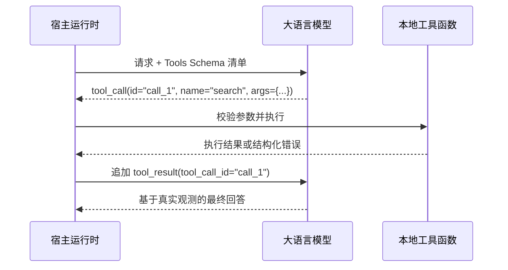

## 一句话定义

**Function Calling（工具调用）** 是大模型根据开发者传入的工具名称、功能描述与 JSON Schema 参数定义，在需要外部数据时输出结构化调用请求（`tool_calls`），由宿主代码执行并返回 `tool` 结果的交互机制。

## 产生背景与需要解决的问题

纯文本模型无法访问实时数据库、私有文件或精确数值计算。早期靠正则解析自然语言动作极易失败；Function Calling 将工具发现和调用意图结构化并纳入模型对话协议。

## 第一性原理

Anthropic 提出了 **ACI（Agent-Computer Interface，智能体-计算机接口）** 概念：就像给人设计优秀 API 和 UI 一样，给模型设计工具时要站在模型视角思考——命名是否直观？参数是否容易填错（如相对路径 vs 绝对路径）？错误信息是否可指导修正？

## 核心运行机制



## 最小可行实现

> 说明：以下为通用 Tool 定义结构（兼容 OpenAI Chat Completions `tools` 字段规范）。

```json
{
  "type": "function",
  "function": {
    "name": "search_knowledge",
    "description": "在本地知识库中按中英文关键词检索条目。优先传入核心术语而非整句长问题。",
    "parameters": {
      "type": "object",
      "properties": {
        "query": { "type": "string", "description": "搜索关键词，例如 'MCP' 或 '循环'" },
        "limit": { "type": "integer", "minimum": 1, "maximum": 20, "default": 5 }
      },
      "required": ["query"],
      "additionalProperties": false
    }
  }
}
```

## 实际应用场景

- 数据库只读查询、知识检索、文件读写与外部服务状态变更。

## 反例与常见误区

- **反例**：一次性向模型注册 60 个功能高度重叠的工具（如 `get_user`, `fetch_user`, `list_users_v2`），导致模型决策混乱并耗尽前置上下文预算。
- **误区**：以为工具函数会在模型服务端执行；实际上模型**绝不会直接运行你的函数**，全部执行都在你自己的宿主进程里发生。

## 工程权衡

- **细粒度多工具 vs 粗粒度复合工具**：工具太碎会增加往返轮次与延迟；适当合并高频关联查询，并在工具内做好输入防呆（poka-yoke），可大幅提高首次调用成功率。

## 关联知识

- 前置：[[llm.structured-output]]、[[agent.loop]] · 延伸：[[tools.schema-validation]]、[[tools.mcp-architecture]]

## 事实分级与参考来源

- **已验证事实**：模型仅生成结构化函数调用参数，宿主负责执行并按 `tool_call_id` 回传结果（OpenAI Function Calling 文档）。
- **工程经验**：投入精力打磨工具文档与防呆参数边界，往往比微调提示词更能提升 Agent 成功率（Anthropic Effective Agents）。
