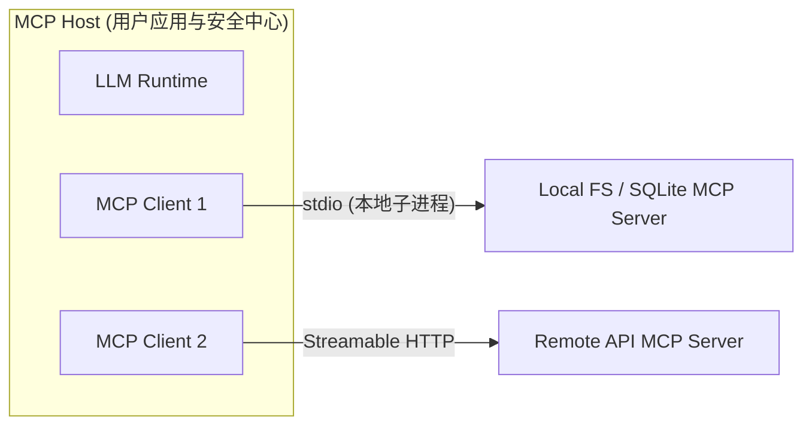

## 一句话定义

**Model Context Protocol (MCP)** 是一个开放应用层协议，用于在 AI 应用（Host）与外部上下文/工具提供方（Server）之间通过 JSON-RPC 2.0 建立标准化的能力发现与受控调用通道。

## 产生背景与需要解决的问题

在 MCP 出现前，如果有 $M$ 个 AI 应用（IDE、桌面客户端、自定义 Agent）和 $N$ 个数据源/工具（Git、数据库、工单系统），就需要编写 $M \times N$ 份互不兼容的适配器胶水代码。MCP 将其收敛为 $M + N$ 的标准接口问题。

## 第一性原理

MCP 借鉴了 **LSP（Language Server Protocol）** 的成功经验：
- **Host**（如 IDE / 桌面工作台）：协调多个 Client、承载 LLM 会话、**拥有最终用户安全授权与采样决策权**。
- **Client**：在 Host 内部维护与某一个 MCP Server 的一对一有状态协议会话。
- **Server**：专注暴露自身领域的 Tools、Resources 与 Prompts 能力，彼此相互隔离。

## 核心运行机制



## 最小可行实现

> 说明：以下为 MCP JSON-RPC 2.0 `tools/list` 请求报文结构示例（规范版本 `2025-03-26`）。

```json
{
  "jsonrpc": "2.0",
  "id": 1,
  "method": "tools/list",
  "params": {}
}
```

## 实际应用场景

- 本地开发 IDE 统一挂载 Git、文档搜索、测试运行器与数据库只读查询服务。

## 反例与常见误区

- **反例**：盲目同时挂载十几个 MCP Server，把上百个工具 Schema 全部注进每次请求，导致上下文窗口被工具定义挤爆（工具膨胀）。
- **误区**：把进程内直接调用几行 TS/Python 函数的内部逻辑也强行拆成独立 MCP Server，平白引入跨进程序列化开销。

## 工程权衡

- **标准化复用 vs 进程开销与信任治理**：本地 stdio Server 与用户同权限运行，接入未审计第三方 MCP Server 等同于在本机执行任意代码，必须在 Host 层严格限制授权与沙箱。

## 关联知识

- 前置：[[tools.function-calling]] · 延伸：[[tools.mcp-primitives]] · 对比：[[multi-agent.a2a-protocol]]

## 事实分级与参考来源

- **已验证事实**：MCP 采用 Host/Client/Server 架构、JSON-RPC 2.0 与 stdio/Streamable HTTP 传输，并明确要求 Host 维护用户授权边界（MCP 官方规范 2025-03-26）。
