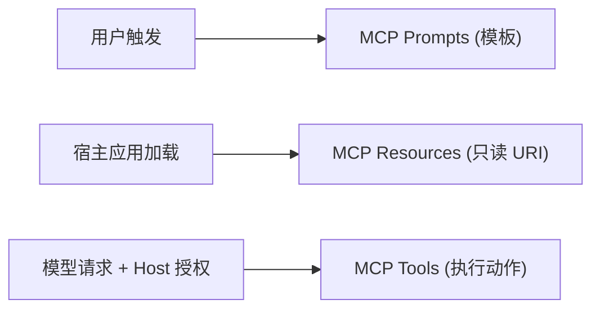

## 一句话定义

MCP 将服务端暴露的能力严格划分为三类原语：**Tools**（模型驱动执行动作）、**Resources**（应用读取只读上下文数据）和 **Prompts**（用户显式触发的标准化工作流模板）。

## 产生背景与需要解决的问题

如果所有数据读取、提示模板和外部写操作全都塞进统一的 `Tool` 接口，不仅增加了 LLM 决策负担，也模糊了“只读观察”与“有副作用动作”的审批边界。

## 第一性原理

三大原语对应三种不同的**控制权归属（Control Model）**：

| 原语 | 控制权归属 | 语义性质 | 典型例子 |
|---|---|---|---|
| **Tools** | Model-controlled（模型决策调用，Host 审批） | 可产生计算或副作用 | 发请求、写文件、查 SQL |
| **Resources** | Application-controlled（宿主/UI 决定挂载） | 只读数据上下文（URI 标识） | 文档正文、Schema、日志切片 |
| **Prompts** | User-controlled（用户显式选择 `/` 命令） | 可复用交互模板 | `/review-pr`、`/summarize` |

## 核心运行机制



## 最小可行实现

> 说明：以下为 MCP `resources/read` 响应示例结构（JSON-RPC 2.0 教学示意）。

```json
{
  "jsonrpc": "2.0",
  "id": 2,
  "result": {
    "contents": [
      {
        "uri": "atlas://knowledge/agent.loop",
        "mimeType": "text/markdown",
        "text": "# Agent 执行循环\n..."
      }
    ]
  }
}
```

## 实际应用场景

- 在桌面知识工作台中，把静态文档、仓库目录树建模为 `Resources`，把需要参数检索或外部写入的能力建模为 `Tools`。

## 反例与常见误区

- **反例**：把一个纯粹静态配置说明文档暴露成 `get_readme` Tool，强迫模型白白多花一轮推理与工具调用去读取它。

## 工程权衡

- **按协议原语拆分 vs 仅依赖 Tools**：目前并非所有模型客户端都完整暴露 Resources/Prompts UI，开发跨客户端 MCP Server 时常以 Tools 为兼容保底，同时保持只读与写操作命名分离（如 `read_*` vs `write_*`）。

## 关联知识

- 前置：[[tools.mcp-architecture]] · 延伸：[[coding.agent-skills]]、[[security.least-privilege-approval]]

## 事实分级与参考来源

- **已验证事实**：MCP 规范将核心原语定义为模型控制的 Tools、应用控制的 Resources 与用户控制的 Prompts（MCP 官方文档）。
