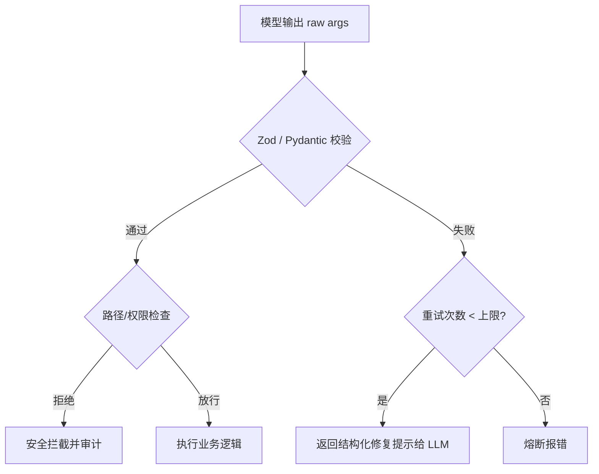

## 一句话定义

**工具参数校验与错误处理** 是在宿主执行实际逻辑前，对模型输出的参数进行强类型、边界与权限验证，并将可恢复的错误以清晰语义回传给模型重试的保护层。

## 产生背景与需要解决的问题

即使开启了 Function Calling，模型仍可能传出类型错误、越界数值、缺失字段或不存在的枚举值。如果不加校验直接透传进业务代码或数据库，轻则抛异常中断流程，重则触发静默数据损坏或注入漏洞。

## 第一性原理

1. **永远不信任概率输出**：所有来自 LLM 的工具参数都属于**不可信外部输入**，必须在信任边界校验。
2. **错误分级**：
   - **可自修正错误**（参数格式/缺字段/越界）→ 返回可读提示，允许有限次重试（如 2 次）。
   - **权限/安全/不可恢复错误**（路径穿越、无权限、下游永久故障）→ 立即拦截并终止或请求人工介入。

## 核心运行机制



## 最小可行实现

```ts
import { z } from 'zod';

const ReadSliceSchema = z.object({
  path: z.string().min(1),
  startLine: z.number().int().min(1),
  endLine: z.number().int().min(1),
});

export function validateToolArgs(raw: unknown) {
  const res = ReadSliceSchema.safeParse(raw);
  if (!res.success) {
    return {
      ok: false as const,
      feedbackForModel: `参数校验失败: ${res.error.issues.map((i) => `${i.path.join('.')}: ${i.message}`).join('; ')}`,
    };
  }
  if (res.data.endLine < res.data.startLine) {
    return { ok: false as const, feedbackForModel: 'endLine 必须大于或等于 startLine' };
  }
  return { ok: true as const, data: res.data };
}
```

## 实际应用场景

- 文件路径读写校验、SQL 查询只读参数校验、分页范围约束。

## 反例与常见误区

- **反例**：把 Node.js/Python 完整异常堆栈、内部绝对磁盘路径甚至数据库连接串原样返回给模型作为 `tool_result`——这会浪费 Token 并可能被提示注入套取敏感环境信息。

## 工程权衡

- **重试次数**：通常 `1–2` 次自修正即可覆盖绝大多数参数笔误；超过 2 次说明工具描述有歧义或模型不具备能力，应果断退出。

## 关联知识

- 前置：[[tools.function-calling]] · 延伸：[[security.least-privilege-approval]]

## 事实分级与参考来源

- **已验证事实**：PydanticAI 等框架通过强类型 Schema 校验并在校验失败时将结构化错误回传模型触发自修正重试（PydanticAI 文档）。
