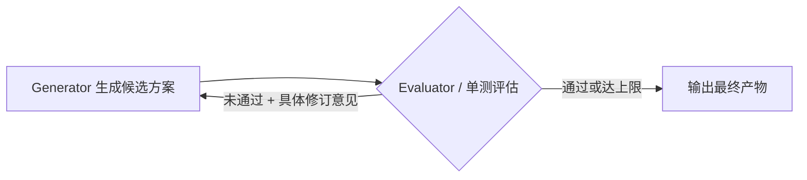

## 一句话定义

**Evaluator-Optimizer** 模式包含一个生成候选方案的 LLM 调用和一个依据明确标准提供反馈的评估节点，两者形成迭代循环，直到评估达标或达到最大修订轮次。

## 产生背景与需要解决的问题

一次生成往往难以同时满足复杂风格、准确性或结构约束；然而让模型在没有任何外部或角色隔离的反馈下空转反思，容易陷入“自我确认偏差”。

## 第一性原理

有效的优化闭环要求**清晰的评估标准（Clear Evaluation Criteria）**与**可操作的修订信号**：
1. 若存在编译器、Linter、单元测试或 Schema 校验器，应优先使用这些**确定性程序评估器**。
2. 只有在语义/风格无法纯靠代码度量时，才引入独立的 Evaluator 模型角色，并明确限制修订轮次（常见 `maxRounds = 2–3`）。

## 核心运行机制



## 最小可行实现

```ts
export async function evaluatorOptimizerLoop(
  draftFn: (feedback?: string) => Promise<string>,
  evaluateFn: (candidate: string) => Promise<{ pass: boolean; feedback: string }>,
  maxRounds = 3,
) {
  let feedback: string | undefined;
  let candidate = '';
  for (let i = 0; i < maxRounds; i++) {
    candidate = await draftFn(feedback);
    const review = await evaluateFn(candidate);
    if (review.pass) return { passed: true, rounds: i + 1, candidate };
    feedback = review.feedback;
  }
  return { passed: false, rounds: maxRounds, candidate };
}
```

## 实际应用场景

- 文学/技术长文翻译精修、多轮搜索完备性核查、测试驱动的代码补丁修复（参见 [[coding.patch-test-review]]）。

## 反例与常见误区

- **反例**：没有清晰 Rubric 标准就让 Evaluator 打分优化，导致两轮之间来回推翻彼此、白耗预算。

## 工程权衡

- **质量提升 vs 延迟倍增**：每多一轮循环至少增加 2 次推理延迟，适合离线或异步高质量生成，不适合强实时交互路径。

## 关联知识

- 前置：[[patterns.prompt-chaining-routing]] · 延伸：[[evals.llm-as-judge-limits]]、[[coding.patch-test-review]]

## 事实分级与参考来源

- **已验证事实**：Evaluator-Optimizer 在具备清晰评估标准且迭代反馈能实质改善输出时最为有效（Anthropic Effective Agents）。
