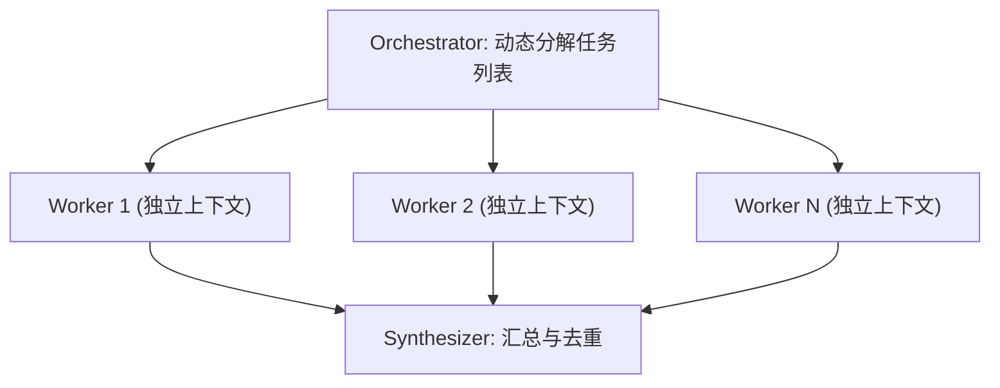

## 一句话定义

**Orchestrator-Workers** 是一种中心 LLM 动态分析输入、决定需要拆解出多少个以及哪类子任务，并将它们分派给多个执行器（Worker），最后由中心汇总结果的协作模式。

## 产生背景与需要解决的问题

静态并发要求开发者在编码时就预先写死分支数量；然而面对“修改跨多个未知文件的代码库”或“调研多个不定链接来源”时，只有运行时根据输入探索后才能确定具体的子任务清单。

## 第一性原理

- **动态任务图生成**：任务分解本身依赖运行时语义理解，而非静态配置。
- **上下文隔离收益**：每个 Worker 只需加载自己那一个小文件或网页片段，避免把所有子任务噪声堆在同一个窗口里。

## 核心运行机制



## 最小可行实现

```ts
export async function orchestrateTasks<T>(
  goal: string,
  planTasks: (g: string) => Promise<string[]>,
  runWorker: (subtask: string) => Promise<T>,
  synthesize: (results: T[]) => Promise<string>,
) {
  const subtasks = await planTasks(goal);
  const results = await Promise.all(subtasks.map((t) => runWorker(t)));
  return synthesize(results);
}
```

## 实际应用场景

- 多文件跨模块重构分析、多源深度研究报告（参见 [[case.web-research-workflow]]）。

## 反例与常见误区

- **反例**：子任务之间存在强先后依赖却盲目 `Promise.all` 并行执行，导致后置 Worker 基于过时假设工作。

## 工程权衡

- **灵活度 vs 成本与失败传播**：必须限制最大 Worker 扇出数量（如 `maxWorkers <= 8`）与单 Worker 预算，并对部分 Worker 失败做好降级汇总。

## 关联知识

- 前置：[[patterns.prompt-chaining-routing]] · 延伸：[[multi-agent.roles-handoffs]]、[[context.engineering-principles]]

## 事实分级与参考来源

- **已验证事实**：Orchestrator-Workers 的核心特征是由 LLM 动态决定子任务拆解而非写死代码分支（Anthropic Effective Agents）。
