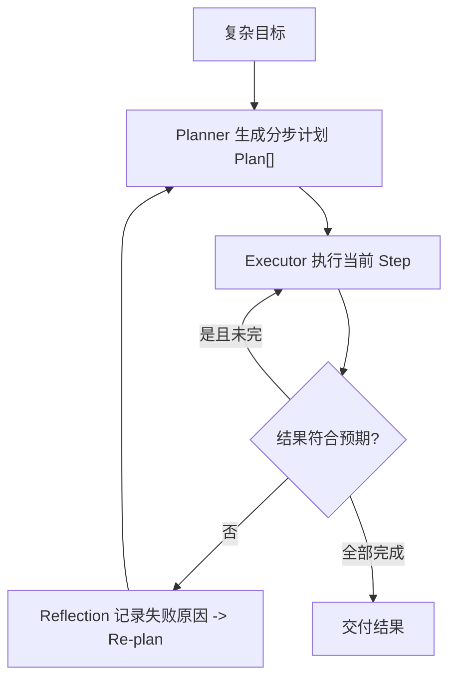

## 一句话定义

**Plan-and-Execute** 先由规划器输出完整有序的步骤清单再交由执行器逐项落实（并在偏差时重规划）；**Reflection / Reflexion** 则在任务失败后生成口头复盘经验存入记忆以指导下次尝试。

## 产生背景与需要解决的问题

纯 ReAct 属于“走一步看一步”的短视贪心策略：面对 10 步以上的复杂工程任务，模型容易迷失全局方向，而且每步都用大模型重算全局上下文非常昂贵。

## 第一性原理

- **规划与执行解耦**：高层 Planner（可选强推理模型）只需在初期与遇到异常时介入；中间常规步骤由轻量 Executor 执行并维护显式 Plan 状态表。
- **口头强化反馈（Verbal Reinforcement）**：在不能更新模型权重的前提下，把上一次失败原因浓缩为简短反思文本注入下一轮上下文，即可避免重蹈覆辙。

## 核心运行机制



## 最小可行实现

```ts
export interface PlanState {
  goal: string;
  steps: Array<{ title: string; status: 'pending' | 'done' | 'failed' }>;
  reflections: string[];
}
```

## 实际应用场景

- 多文件软件工程改造（见 [[case.multi-model-collaboration]]）、复杂长周期研究任务。

## 反例与常见误区

- **反例**：死板执行过期计划——第一步已经发现核心文件根本不存在，执行器却不触发 Re-plan 硬往下跑第 2–5 步。

## 工程权衡

- **全局视野与省成本 vs 环境动态性**：如果外部环境变化极快（每一步都会彻底推翻前面假设），高频重规划反而比不上简洁的 ReAct 循环。

## 关联知识

- 前置：[[patterns.react]] · 延伸：[[harness.budget-recovery]]、[[workflow.dag-state-machine]]

## 事实分级与参考来源

- **已验证事实**：Reflexion（Shinn et al., NeurIPS 2023）证明将二值/标量反馈转化为文本自我反思并持久记忆能显著提升多次尝试成功率。
