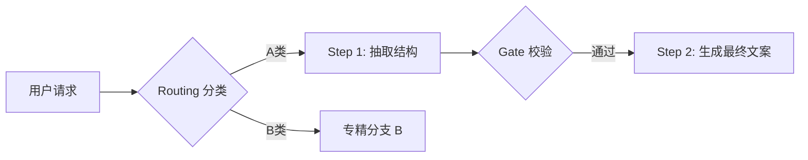

## 一句话定义

**提示链（Prompt Chaining）** 将任务分解为顺序衔接的固定子步骤；**路由（Routing）** 先对输入意图分类，再分发给专精下游处理分支。

## 产生背景与需要解决的问题

把复杂的多步骤需求、十几种业务分支和风格规则全部塞进一次大 Prompt 里，不仅输出质量下降，也难以定位哪一段指令失败。拆分与分流能将复杂问题转化为可独立测试的子任务。

## 第一性原理

- **分解降熵**：单步目标越单一，模型注意力越集中，输出格式也越容易通过程序 Gate 校验。
- **关注点隔离（Separation of Concerns）**：路由后，退款分支不需要看到技术排查工具，既省 Token 又降低误调用概率。

## 核心运行机制



## 最小可行实现

```ts
export async function routeAndRun(
  input: string,
  classify: (s: string) => Promise<'billing' | 'tech'>,
  handlers: Record<'billing' | 'tech', (s: string) => Promise<string>>,
) {
  const category = await classify(input);
  return handlers[category](input);
}
```

## 实际应用场景

- 文档翻译流：初译 → 术语表校对 Gate → 润色。
- 客服工单分诊、安全审核并行（Parallelization Guardrails）与主回复并行执行。

## 反例与常见误区

- **反例**：把原本可在 1 次结构化调用中完成的小任务硬拆成 5 个串联 Prompt，平白把端到端延迟放大 5 倍。

## 工程权衡

- **延迟 vs 单步准确率**：串联步骤越多总延迟越高；对于彼此无依赖的检查项（如安全审核与摘要），应改用并行执行（Sectioning / Voting）。

## 关联知识

- 前置：[[agent.taxonomy]] · 延伸：[[patterns.orchestrator-workers]] · 对比：[[patterns.react]]

## 事实分级与参考来源

- **已验证事实**：Prompt Chaining、Routing 与 Parallelization 是 Anthropic 工程实践总结的三大基础 Workflow 模式（Anthropic Effective Agents）。
