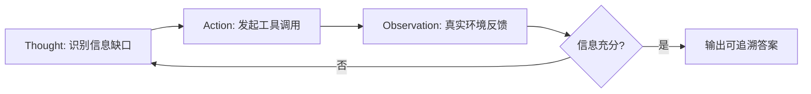

## 一句话定义

**ReAct（Synergizing Reasoning and Acting）** 是由 Yao 等人提出的经典 Agent 范式，使模型在一个统一闭环中交错生成**推理轨迹（Thought）**与**特定任务动作（Action）**，并消费环境返回的**观察（Observation）**。

## 产生背景与需要解决的问题

纯 Chain-of-Thought（CoT）只做内部思维推理，缺乏对外部实时世界或私有知识的访问能力，一旦中间某步事实回忆出错就会产生连环幻觉；而纯动作模型缺乏规划与异常恢复能力。ReAct 将两者结合起来。

## 第一性原理

- **推理指导行动**：Thought 帮助模型拆解当前子目标、选择正确工具并处理工具失败。
- **行动锚定推理**：Observation 从真实数据库/检索器引入外部事实，及时纠正模型内部参数知识的错误或过时。

## 核心运行机制



## 最小可行实现

> 说明：现代原生 Tool Calling 模型已将 Action 转为结构化 `tool_calls`，不必完全依赖早期文本正则解析 `Action:`。以下展示概念轨迹结构：

```text
Thought 1: 需要核对 MCP 协议规定的三大核心原语，不能仅凭记忆作答。
Action 1: search_knowledge(query="MCP Primitives")
Observation 1: 命中 tools.mcp-primitives -> Tools, Resources, Prompts。
Thought 2: 事实已核实完毕，可以输出带引用的最终答案。
Final Answer: MCP 核心原语包括 Tools、Resources 与 Prompts [tools.mcp-primitives]。
```

## 实际应用场景

- 多跳知识问答、动态环境排查、结合搜索的工具型问答助手。

## 反例与常见误区

- **误区**：在现代支持原生 `tool_calls` 与推理标签的模型上，还强行在文本里用脆弱的字符串正则去匹配 `Thought:/Action:`，增加解析崩溃率。
- **反例**：对 Observation 返回的外部网页文本不加信任隔离，容易遭受间接提示注入（演练 Playground `react` 故障注入）。

## 工程权衡

- **灵活性 vs 上下文膨胀**：每轮 Thought+Action+Observation 都会追加历史，较长任务需要结合 [[context.budget-compaction]]。

## 关联知识

- 前置：[[agent.loop]]、[[tools.function-calling]] · 延伸：[[patterns.plan-execute-reflection]]

## 事实分级与参考来源

- **已验证事实**：ReAct 论文（Yao et al., ICLR 2023）验证了交错推理与行动在 HotpotQA 与 Fever 上显著降低幻觉率。
