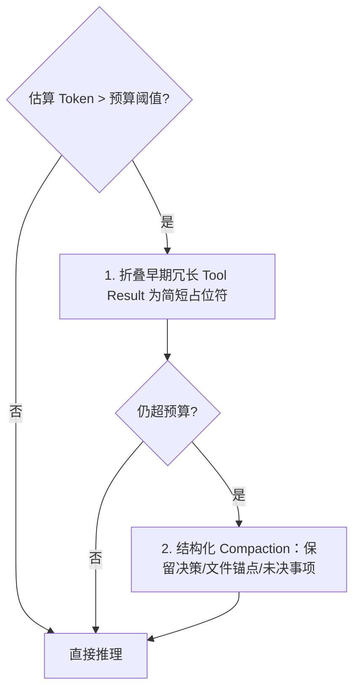

## 一句话定义

**上下文预算与压缩（Context Budget & Compaction）** 是一套在多轮历史接近窗口或成本阈值时，主动清理陈旧工具输出、并将早期过程浓缩为结构化状态摘要以维持推理清晰度的机制。

## 产生背景与需要解决的问题

即使按需读取文件，经过 20–30 轮工具迭代后，对话历史依然会触及模型窗口极限或造成不可接受的延迟与账单。

## 第一性原理

历史信息随时间价值衰减不均：
- **高频可丢弃（Low-entropy stale observations）**：10 轮以前读过的长文件内容或成功日志。
- **永久必须保留（High-signal anchors）**：System 安全指令、初始目标、已作出的设计决策、尚未修复的报错、当前变更文件清单。

因此最优顺序是：**先清理旧工具返回体（Tool Result Clearing） → 仍超预算再执行结构化摘要（Compaction）**。

## 核心运行机制



## 最小可行实现

> 可在 Playground `context-engineering` 实验中亲自对比 `truncate-head`（反例）、`filter-tool` 与 `compact` 三种模式。

```ts
export interface CompactionSummary {
  originalGoal: string;
  confirmedDecisions: string[];
  modifiedFiles: string[];
  unresolvedErrors: string[];
}
```

## 实际应用场景

- 长周期 Coding Agent、跨数十次工具调用的研究会话。

## 反例与常见误区

- **反例**：只保留最后 $K$ 条消息、把数组前面全部裁掉（`messages.slice(-10)`）——往往把用户最初的约束或关键架构要求裁没了。

## 工程权衡

- **无损保真 vs 窗口连续性**：每次摘要压缩都会损失部分细枝末节，因此必须把文件路径、节点 ID 等精确标识符原样写入摘要锚点，必要时允许模型用工具重新读取原文。

## 关联知识

- 前置：[[context.engineering-principles]] · 延伸：[[harness.budget-recovery]]、[[memory.architecture-lifecycle]]

## 事实分级与参考来源

- **已验证事实**：工具结果清理（Tool Result Clearing）与结构化 Compaction 是 Anthropic 推荐的长程 Agent 核心上下文治理手段。
