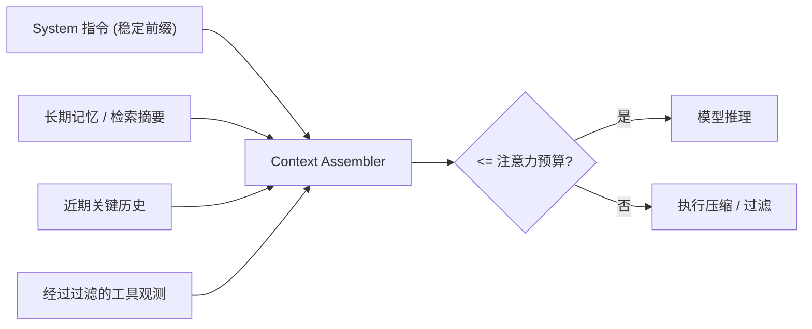

## 一句话定义

**Context Engineering（上下文工程）** 是 Prompt Engineering 的系统化演进：关注如何在多轮运行过程中动态管理进入模型上下文窗口的所有信息（系统指令、工具定义、记忆、检索结果、历史与工具输出），在最短篇幅内提供最高信号密度。

## 产生背景与需要解决的问题

早期提示工程主要关心“写好一条一次性系统提示”。而在真实 Agent 中，每一轮循环都在向窗口堆叠大量工具返回、代码文件内容与中间对话，如果不加策展治理，**Context Rot（上下文腐烂）** 会迅速导致指令失灵、幻觉上升和成本飙升。

## 第一性原理

Anthropic 提出的核心直觉是把上下文看作**稀缺的注意力预算（Attention Budget）**：
1. **信号/噪声比优先于单纯堆信息量**。
2. **明确系统指令海拔高度（Altitude）**：太死板脆弱的 `if/else` 规则不可扩展，太抽象空洞的口号又无法指导行为；应给出清晰边界原则与典型示例。
3. **混合加载策略**：轻量核心元信息（如 `AGENTS.md` / 目录结构）预先注入，重型文件内容通过工具 **Just-in-time（按需即时读取）**。

## 核心运行机制



## 最小可行实现

```ts
export function filterLargeToolOutput(rawOutput: string, maxChars = 2400): string {
  if (rawOutput.length <= maxChars) return rawOutput;
  const head = rawOutput.slice(0, 1400);
  const tail = rawOutput.slice(-600);
  return `${head}\n\n... [已省略 ${rawOutput.length - 2000} 字符冗余中间输出；如需局部查看请指定行号] ...\n\n${tail}`;
}
```

## 实际应用场景

- 长对话编程助手、大型数据库/文档库按需切片读取。

## 反例与常见误区

- **反例**：直接把 `npm test` 失败时的 8,000 行全量依赖构建日志原封不动塞进历史消息，把前面关键的用户要求彻底淹没。

## 工程权衡

- **预加载 vs 按需工具拉取**：预加载少一次工具往返延迟，但浪费无关 Token；高命中率核心规范可预置，长文档与大文件一律按需切片读取。

## 关联知识

- 前置：[[llm.tokens-context]]、[[agent.loop]] · 延伸：[[context.budget-compaction]]、[[context.state-vs-context]]

## 事实分级与参考来源

- **已验证事实**：Anthropic《Effective context engineering for AI agents》系统定义了 Context Rot、Just-in-time 检索与高信噪比策展原则。
