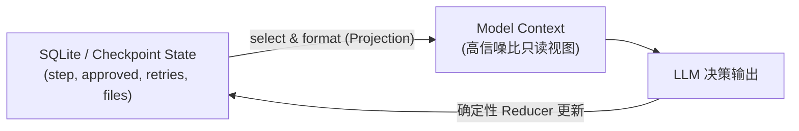

## 一句话定义

**State（程序状态）** 是宿主系统维护的结构化、强类型、可持久化的事实真相源（Source of Truth）；**Context（模型上下文）** 是在每步推理时从 State 与外部记忆中挑选、格式化后投影给 LLM 的临时只读视图。

## 产生背景与需要解决的问题

很多早期 Agent 直接把一个 `messages[]` 数组当成系统的全部状态：既用来和模型聊天，又企图从文本里推断任务进行到第几步、用户是否已批准权限、哪些文件已处理完。这种做法极其脆弱，一旦做上下文压缩，系统状态就会丢失。

## 第一性原理

- **State 决定程序控制权、权限与持久化恢复**，由确定性代码读写（如 SQLite）。
- **Context 服务于下一步模型推理质量**，允许被裁剪、折叠、重排或按角色过滤（例如绝不把敏感凭据投影到 Context 中）。

## 核心运行机制



## 最小可行实现

```ts
export interface WorkflowState {
  runId: string;
  stepCount: number;
  approved: boolean;
  internalApiKey: string; // 仅留在宿主 State/Vault，绝不投影进 Context
  findings: string[];
}

export function buildModelContext(state: WorkflowState): string {
  return `当前步数: ${state.stepCount}\n审批状态: ${state.approved}\n已有发现:\n${state.findings.slice(-5).join('\n')}`;
}
```

## 实际应用场景

- 安全凭据隔离、人工审批状态持久保存、Compaction 后不丢失步数和已完成清单。

## 反例与常见误区

- **反例**：在 System Prompt 中注入一个假装受保护的 API Token 并嘱咐模型“不要告诉用户”；一旦发生提示注入，该秘密必然泄漏。正确做法是根本不让秘密进入 Context。

## 工程权衡

- **显式 State 建模成本 vs 系统可维护性**：初期需要定义好 State Schema 与 Reducer，但换来独立测试、断点恢复与严格安全隔离能力。

## 关联知识

- 前置：[[agent.state-environment]]、[[context.engineering-principles]] · 延伸：[[workflow.checkpoint-durability]]

## 事实分级与参考来源

- **已验证事实**：LangGraph 等状态图框架将共享 State 与传递给模型的 Messages/Context 显式分离管理。
