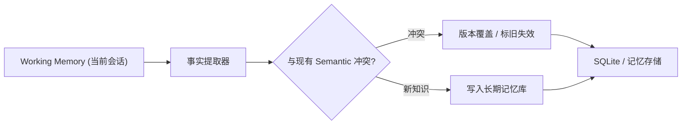

## 一句话定义

**Agent Memory（记忆系统）** 是超越单次上下文窗口生命周期的持久化信息管理架构，通常分为 **Working Memory（当前会话工作缓冲）**、**Episodic Memory（过往任务轨迹经验）** 与 **Semantic Memory（提炼后的结构化事实与偏好）**。

## 产生背景与需要解决的问题

上下文窗口是易失且昂贵的短期 RAM；如果每次新会话都要用户重复说明技术栈、编码规范和历史结论，体验极差；但如果不加筛选地把全部历史对话原封不动写进数据库并全量召回，过时矛盾的信息会严重干扰当前决策。

## 第一性原理

借鉴操作系统虚拟内存与人类记忆分层（参见 MemGPT）：
1. **记忆写入（Write）不是全量日志**：只提取高价值事实与偏好，绑定键、版本号和时间戳。
2. **冲突消解（Reconcile）**：当新事实推翻旧事实时（例如迁移数据库），必须显式 `supersede`（标记旧版本失效或覆盖），不能 `append-only` 并存。
3. **用户可控与可删除**：涉及个人偏好或敏感事实的长期记忆必须可查看、编辑与删除。

## 核心运行机制



## 最小可行实现

> 可在 Playground `memory` 实验对比 `upsert-versioned` 与 `append-only` 故障效果。

```ts
export interface SemanticFact {
  key: string;
  value: string;
  revision: number;
  active: boolean;
  updatedAt: string;
}

export function upsertSemanticFact(store: SemanticFact[], key: string, value: string): SemanticFact[] {
  const activeOld = store.filter((f) => f.key === key && f.active);
  const nextRev = activeOld.reduce((m, f) => Math.max(m, f.revision), 0) + 1;
  const archived = store.map((f) => (f.key === key ? { ...f, active: false } : f));
  return [...archived, { key, value, revision: nextRev, active: true, updatedAt: new Date().toISOString() }];
}
```

## 实际应用场景

- 跨会话个人学习习惯记忆、Coding Agent 跨任务项目经验沉淀（如记录构建失败修复经验）。

## 反例与常见误区

- **反例**：把所有聊天记录直接当成长期记忆做模糊检索，导致 3 个月前的一次临时调试指令在今天被错误召回执行。

## 工程权衡

- **自动提取写入 vs 用户确认写入**：关键偏好与知识沉淀建议采用“提取草稿 → 用户/规则确认”或保留可回滚版本历史，避免幻觉污染长期记忆库。

## 关联知识

- 前置：[[context.state-vs-context]] · 延伸：[[context.budget-compaction]]、[[security.least-privilege-approval]]

## 事实分级与参考来源

- **已验证事实**：MemGPT（Packer et al., 2023）提出了分层内存管理与主动读写控制模型；Microsoft AI Agents for Beginners 第 13 课系统梳理了 Agent Memory 分层治理。
