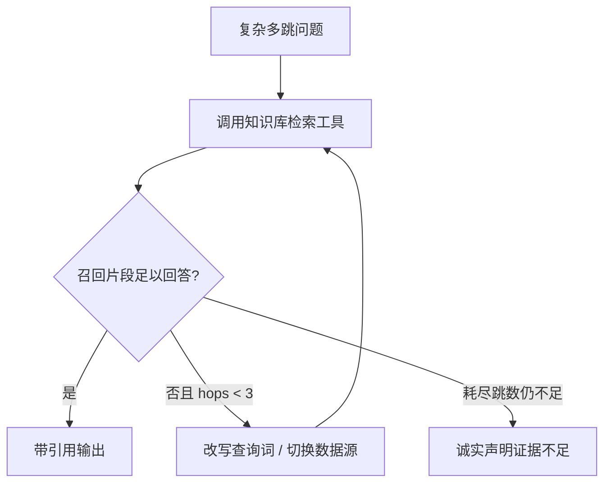

## 一句话定义

**Agentic RAG** 将检索器作为工具暴露给 Agent，由模型根据查询复杂性与初步召回质量，动态执行查询拆解、同义改写、多数据源路由或拒绝作答。

## 产生背景与需要解决的问题

传统固定单跳 RAG 面对复合问题（例如“对比 LangGraph 与 OpenAI Agents SDK 的状态持久化差异并对照本地案例”）时，一次检索往往只能命中其中一半文档，或者因用户口语化提问导致关键词失配。

## 第一性原理

把**“检索充分性判断”**纳入控制循环：
1. 若初次 Top-K 片段已覆盖问题所有约束 → 直接生成（单跳快路径）。
2. 若缺乏关键依据 → 改写查询词或拆分为两个子检索再执行一轮（有限跳数，如 `maxHops <= 3`）。
3. 若多次检索仍无证据 → 明确报告“现有资料无法支持结论”。

## 核心运行机制



## 最小可行实现

```ts
export async function adaptiveSearch(
  question: string,
  searchFn: (q: string) => Promise<string[]>,
  rewriteFn: (q: string, prevCount: number) => Promise<string>,
) {
  let query = question;
  for (let hop = 0; hop < 3; hop++) {
    const docs = await searchFn(query);
    if (docs.length >= 2) return { query, docs, hops: hop + 1 };
    query = await rewriteFn(question, docs.length);
  }
  return { query, docs: [], hops: 3 };
}
```

## 实际应用场景

- 跨模块技术对比研究、代码库多文件依赖追踪、复杂客服故障定位。

## 反例与常见误区

- **反例**：无论用户问多简单的问题（例如“什么是 Token？”）都强制先走 3 轮 Agentic 拆解改写，白白增加 3–5 秒延迟。

## 工程权衡

- **召回覆盖率 vs 首字延迟**：最佳实践是“快路径直出 + 低置信才升级 Agentic 重试”。

## 关联知识

- 前置：[[rag.hybrid-rerank]]、[[agent.loop]] · 延伸：[[patterns.react]]

## 事实分级与参考来源

- **已验证事实**：Hugging Face Agents Course 与 Microsoft AI Agents for Beginners 均将自省查询改写与多工具路由归为 Agentic RAG 核心特征。
