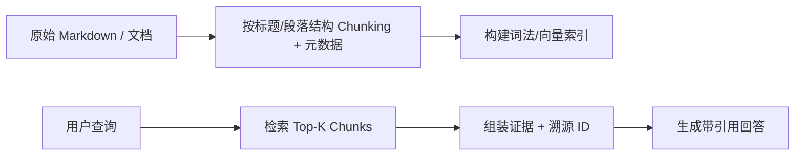

## 一句话定义

**RAG（Retrieval-Augmented Generation）** 在模型生成答案之前，先从外部受控知识库检索与当前问题最相关的文本切片（Chunks）注入上下文，使模型依据可验证的外部证据而非仅凭训练参数作答。

## 产生背景与需要解决的问题

LLM 的预训练权重是静态快照，既不包含企业/个人私有知识，也会随时间过时，且容易产生“流畅的胡说八道”。全量微调成本高且难以做到每条知识即时更新与精确溯源。

## 第一性原理

- **参数记忆（Parametric Memory）与非参数记忆（Non-parametric Memory）分离**：推理能力留在模型权重里，具体事实与规范留在外部可增删改查的索引里。
- **Chunking 黄金矛盾**：Chunk 太小会切断跨段落因果与代码示例边界；Chunk 太大则会引入大量无关噪声并挤压 Top-K 数量。

## 核心运行机制



## 最小可行实现

```ts
export function chunkMarkdownByHeadings(md: string, maxChars = 600): Array<{ heading: string; text: string }> {
  const sections = md.split(/\n(?=##\s)/);
  const chunks: Array<{ heading: string; text: string }> = [];
  for (const sec of sections) {
    const firstLine = sec.split('\n')[0] || 'Intro';
    if (sec.length <= maxChars) {
      chunks.push({ heading: firstLine, text: sec });
    } else {
      for (let i = 0; i < sec.length; i += maxChars - 80) {
        chunks.push({ heading: firstLine, text: sec.slice(i, i + maxChars) });
      }
    }
  }
  return chunks;
}
```

## 实际应用场景

- 技术百科问答、企业内部制度/API 手册检索、带可点击引用徽章的研究工作台。

## 反例与常见误区

- **反例**：按固定 500 字符生硬切分，把一个 Markdown 代码块或表格从正中间腰斩，导致检索出来既不可读又丢失字段含义。

## 工程权衡

- **结构化切分 vs 固定滑窗**：技术文档优先按 `##` 标题与代码块边界切分，并保留文档标题、面包屑作为每个 Chunk 的前缀上下文。

## 关联知识

- 前置：[[llm.tokens-context]] · 延伸：[[rag.hybrid-rerank]]、[[rag.agentic-rag]]

## 事实分级与参考来源

- **已验证事实**：RAG 架构（Lewis et al., NeurIPS 2020）通过外部非参数检索记忆显著提升知识密集型任务的事实准确性与可追溯性。
