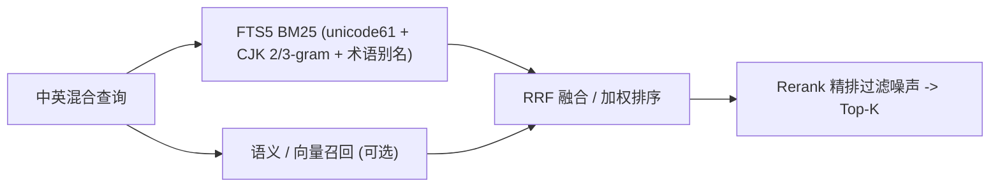

## 一句话定义

**混合检索（Hybrid Search）** 同时运行精确词法匹配（BM25/倒排索引）与语义相似度检索并融合排名；**重排（Rerank）** 在初筛候选集上运行更精细的相关性打分器，把真正回答问题的片段推到最前面。

## 产生背景与需要解决的问题

纯向量检索擅长同义改写（如“怎么让智能体停下来”匹配“停止条件”），但对专有缩写（`MCP`、`A2A`）、报错码（`ERR_SQLITE_ERROR`）和精确符号往往表现不佳；而纯关键词检索又容易漏掉同义表达。此外，在本地 SQLite FTS5 中直接启用 `trigram` 分词器会要求至少 3 个字符才能走索引，导致“循环”“状态”“记忆”等两字中文技术术语直接失效。

## 第一性原理

1. **双路召回互补**：BM25 保证字面精确标识符必中；语义/同义词扩展保证概念泛化召回。
2. **倒排融合与重排**：先用轻量方法低延迟召回 Top-20，再用高成本 Cross-Encoder 或多字段加权（标题权重 > 别名 > 正文）精排至 Top-4 送入上下文。

## 核心运行机制



## 最小可行实现

> 说明：以下展示本平台实测验证的中文 FTS5 2/3-gram 索引建词函数（Node.js 24 + SQLite 3.50.4）。

```ts
export function tokenizeCJK(text: string): string {
  const tokens: string[] = [];
  const runs = text.match(/[\u4e00-\u9fff]+/g) || [];
  for (const run of runs) {
    if (run.length === 1) {
      tokens.push(run);
      continue;
    }
    for (let i = 0; i < run.length; i++) {
      if (i + 1 < run.length) tokens.push(run.slice(i, i + 2));
      if (i + 2 < run.length) tokens.push(run.slice(i, i + 3));
    }
  }
  return tokens.join(' ');
}
```

## 实际应用场景

- 本地桌面技术百科（无需外接 GPU/云端向量库即可实现毫秒级中英混合精确命中）。

## 反例与常见误区

- **反例**：为了做简单文档库检索就盲目引入重型分布式向量集群，忽视基础的标题加权、同义词字典与中文 2-gram 词法索引。

## 工程权衡

- **本地零依赖 FTS5 vs 向量 Embedding**：在数千篇规模的专业文档库上，结构化 FTS5 + 术语同义词扩展在延迟（毫秒级）和精准度上常优于未经调优的纯向量方案；跨语种模糊问答场景可按需叠加本地小型 Embedding。

## 关联知识

- 前置：[[rag.fundamentals-chunking]] · 延伸：[[rag.agentic-rag]]、[[deployment.local-offline-ops]]

## 事实分级与参考来源

- **已验证事实**：SQLite FTS5 `trigram` 分词器默认对少于 3 字符的输入退化或无命中（SQLite FTS5 文档）；本地实测 `unicode61 + CJK 2/3-gram` 可稳定命中两字中文与英文缩写。
