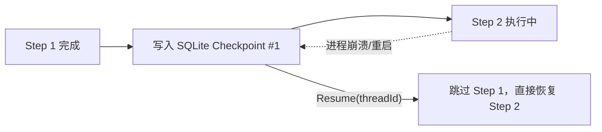

## 一句话定义

**Checkpoint（检查点）** 是在工作流每一步（Super-step）边界将当前完整可序列化 State 持久化写入本地数据库（如 SQLite）或对象存储的快照机制，使执行流可以安全暂停并在稍后准确恢复。

## 产生背景与需要解决的问题

一次深度调研或代码重构工作流可能需要几十分钟甚至等待人类半小时后审批，期间一旦进程崩溃、重启或网络断连，如果所有状态只在内存里，之前的全部模型费用与进展将付之东流。

## 第一性原理

**确定性重放与状态快照**：只要节点函数以当前持久 State 为输入并把新状态写回下一版 Checkpoint，系统重启后便无需重跑已经成功落盘的前置步骤，直接从最后检查点继续推进。

## 核心运行机制



## 最小可行实现

```ts
export interface CheckpointSnapshot<S> {
  threadId: string;
  checkpointId: string;
  nextNode: string;
  state: S;
  createdAt: string;
}
```

## 实际应用场景

- 长程任务断点续跑（见 [[case.long-running-recovery]]）、时间旅行调试（Time-travel debugging）定位某一步为什么出错。

## 反例与常见误区

- **反例**：把不可序列化的数据库 Socket 连接、函数闭包或 API Key 明文放进 State 对象，导致 Checkpoint 序列化失败或泄露秘密。

## 工程权衡

- **持久化粒度 vs I/O 延迟**：每个 Super-step 写一次 SQLite WAL 仅毫秒级开销，远低于一次 LLM 调用的数百至数千毫秒，极具性价比。

## 关联知识

- 前置：[[workflow.dag-state-machine]] · 延伸：[[workflow.hitl-idempotency]]、[[harness.budget-recovery]]

## 事实分级与参考来源

- **已验证事实**：LangGraph Checkpointer（SQLite/Postgres）基于线程与检查点 ID 实现断点恢复与中断挂起（LangGraph 文档）。
