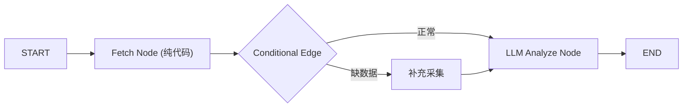

## 一句话定义

**DAG 与有状态工作流图** 用显式的节点（Nodes）、边（Edges）、条件分支（Conditional Edges）和共享类型化状态（State）来定义 AI 系统的控制流，将 LLM 调用包裹在确定性工程骨架内。

## 产生背景与需要解决的问题

纯脚本串联难以表达并发扇出、条件回环和人工中断；而完全把一切交给自由 Agent Loop 又容易失控。有向状态图在“完全写死”与“完全自由”之间提供了精确可控的工程中间层。

## 第一性原理

- **Nodes 是动作单元**（可以是纯函数、工具、也可以是单步 LLM 调用）。
- **Edges 是确定性控制拓扑**（固定跳转或条件路由函数决定下一跳）。
- **State Reducer 保证并发一致性**：多个并行节点返回局部增量后，通过明确归约规则合并进全局 State。

## 核心运行机制



## 最小可行实现

```ts
export type NodeFn<S> = (state: S) => Promise<Partial<S>>;

export async function runLinearStateGraph<S extends object>(
  initial: S,
  nodes: Array<{ name: string; run: NodeFn<S> }>,
): Promise<S> {
  let state = { ...initial };
  for (const node of nodes) {
    const patch = await node.run(state);
    state = { ...state, ...patch };
  }
  return state;
}
```

## 实际应用场景

- 文档审批、批量数据流水线、融合局部自主循环的生产工作流。

## 反例与常见误区

- **反例**：只有 2 个固定串行函数调用，却强行引入复杂分布式状态图引擎和外部消息队列。

## 工程权衡

- **显式图建模开销 vs 长期可观察性**：图结构天然支持单节点回放、可视化调试与独立单元测试。

## 关联知识

- 前置：[[agent.taxonomy]]、[[context.state-vs-context]] · 延伸：[[workflow.checkpoint-durability]]

## 事实分级与参考来源

- **已验证事实**：LangGraph 通过共享 State、Nodes 与 Conditional Edges 将工作流与循环统一为可持久化状态图（LangGraph 文档）。
