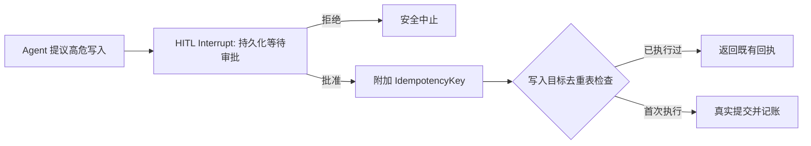

## 一句话定义

**HITL（人在回路）** 是在不可逆或高权限动作前由运行时挂起状态机等待人工批准或修正参数的机制；**幂等性（Idempotency）** 保证在断点恢复或网络重试时同一意图最多生效一次。

## 产生背景与需要解决的问题

持久执行架构往往提供“至少一次（At-least-once）”重试保证：如果工具已发出了转账、建工单或写入请求但响应超时，恢复重跑时会再次触发该节点，没有幂等键就会产生重复副作用。

## 第一性原理

1. **控制权交还人类**：模型只能“提议（Propose）”，高危执行必须经宿主拦截并向用户展示精确参数预览。
2. **确定性幂等键**：用 `hash(runId + stepId + targetAction)` 作为业务幂等键传给外部 API 或本地事务日志表，重复请求直接返回已有结果。

## 核心运行机制



## 最小可行实现

```ts
const processedKeys = new Set<string>();

export async function idempotentWrite(idempotencyKey: string, action: () => Promise<string>) {
  if (processedKeys.has(idempotencyKey)) {
    return { skippedDuplicate: true, status: 'already_applied' };
  }
  const result = await action();
  processedKeys.add(idempotencyKey);
  return { skippedDuplicate: false, result };
}
```

## 实际应用场景

- 敏感数据覆盖、生产备份恢复、发送外部邮件或财务审批网关（参见 [[case.sensitive-tool-gateway]]）。

## 反例与常见误区

- **反例**：审批弹窗只写“是否允许继续？”，不显示具体路径、金额或修改条数，导致用户习惯性盲点确认（Approval Fatigue）。

## 工程权衡

- **人工介入频率 vs 流畅度**：只对高影响/不可逆动作设置 HITL 中断，低风险只读检索保持全自动，避免审批疲劳。

## 关联知识

- 前置：[[workflow.checkpoint-durability]]、[[tools.schema-validation]] · 延伸：[[security.least-privilege-approval]]

## 事实分级与参考来源

- **已验证事实**：LangGraph `interrupt()` 借助持久检查点暂停等待用户输入；OWASP LLM Top 10 将过度代理权限与缺乏人工确认列为高危风险。
