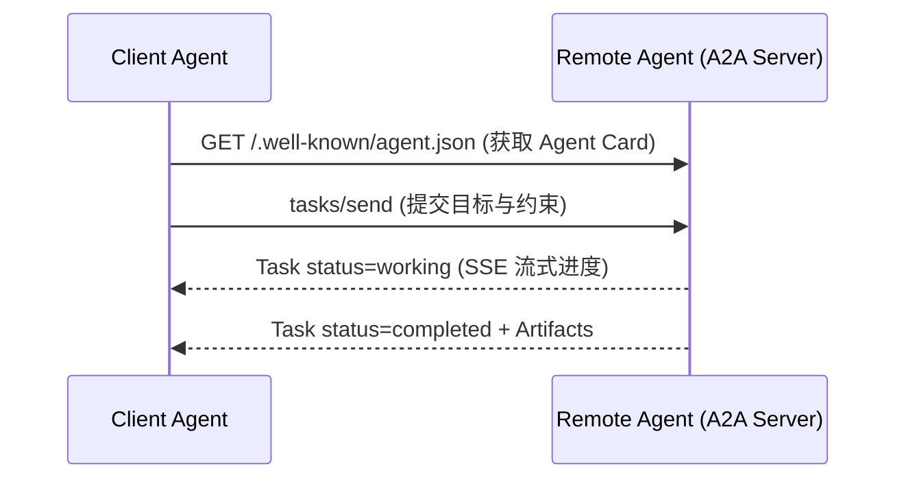

## 一句话定义

**Agent2Agent (A2A)** 是一套开放通信协议，使不同框架（LangGraph、ADK、CrewAI 等）或不同服务边界构建的独立 Agent 能够彼此发现能力、委派异步任务并交换结构化成果（Artifacts），而无需共享内部私有记忆或工具实现。

## 产生背景与需要解决的问题

MCP 解决了“一个 Agent 连接各种工具/数据源”的横向集成问题；但当企业内部多个团队各自运行独立的远程 Agent 服务时，需要一种标准方式让它们作为对等主体安全协作。

## 第一性原理

- **不透明协同（Opaque Execution）**：远端 Agent 不需要暴露自己的内部 Prompt、模型参数或工具清单，只需暴露标准 `Agent Card`（声明能力、技能与认证要求）和异步 `Task` 接口。
- **MCP 与 A2A 互补**：Agent 内部用 **MCP** 调工具，Agent 之间跨网络边界用 **A2A** 委派任务。

## 核心运行机制



## 最小可行实现

> 说明：以下为 A2A Agent Card 核心字段示意结构（参考 `a2a-protocol.org`）。

```json
{
  "name": "SecurityAuditAgent",
  "url": "https://audit.internal.example/a2a",
  "version": "1.0.0",
  "capabilities": { "streaming": true },
  "skills": [
    { "id": "scan-dependencies", "name": "Dependency Risk Audit" }
  ]
}
```

## 实际应用场景

- 跨部门系统对接（研发 Agent 委派法务合规 Agent 审查开源许可证并获取签名报告）。

## 反例与常见误区

- **反例**：在同一个本地单进程应用里把两个内部函数也强行包装成 HTTP + A2A 服务端来互调，完全属于过度设计。

## 工程权衡

- **异构边界解耦 vs 分布式系统复杂度**：引入 A2A 意味着网络超时、跨服务鉴权、异步状态轮询等分布式运维成本，只适合跨进程/跨团队边界。

## 关联知识

- 前置：[[tools.mcp-architecture]]、[[multi-agent.roles-handoffs]] · 延伸：[[multi-agent.cost-boundaries]]

## 事实分级与参考来源

- **已验证事实**：A2A 协议基于 HTTP/JSON-RPC/SSE 定义了 Agent Card（`/.well-known/agent.json`）、Task 状态与 Artifact 交换模型（a2a-protocol.org）。
