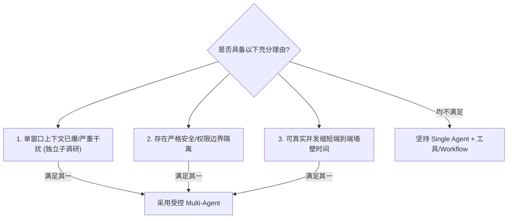

## 一句话定义

**多智能体成本与边界治理** 旨在权衡拆分多个 Agent 带来的上下文隔离收益与随之而来的 Token 乘数放大、序列化协调延迟以及全局状态一致性难题。

## 产生背景与需要解决的问题

多 Agent 往往被包装为“默认高级架构”，但实测中盲目拆分成多个互相对话的 Agent 常导致：成本暴涨数倍、中间简报丢失关键前提、错误在交接链条中静默放大。

## 第一性原理

1. **Token 放大公式**：每次交接都要在新 Agent 窗口重新建立系统提示和任务背景，若有 $N$ 个 Agent 多轮来回，总消耗常常是同等单 Agent 的 $3\times - 15\times$。
2. **通信带宽远小于内部注意力**：同一个上下文窗内连续推理可以无损引用前面细节；跨 Agent 只能通过显式文本简报传递，必然产生压缩损耗（Telephone Game 效应）。

## 核心运行机制



## 最小可行实现

> 可在 Playground `multi-agent` 实验对比 `single-agent` 与 `supervisor` 的交接次数和模拟 Token 消耗差异。

```ts
export function shouldUseMultiAgent(criteria: {
  independentLargeContexts: boolean;
  strictSecurityIsolation: boolean;
  trueParallelWallTimeGain: boolean;
}): boolean {
  return (
    criteria.independentLargeContexts ||
    criteria.strictSecurityIsolation ||
    criteria.trueParallelWallTimeGain
  );
}
```

## 实际应用场景

- 架构评审会（Architecture Review）作为“是否需要拆分 Multi-Agent”的决策门禁。

## 反例与常见误区

- **反例**：写一个“写诗 Agent + 押韵检查 Agent + 标题 Agent + 排版 Agent”的四智能体系统，其实一次结构化输出就能做得更好更快。

## 工程权衡

- **单 Agent 简洁性 vs 隔离收益**：优先用单 Agent + 结构化工具 + 清晰 Workflow 阶段；直到实测出现注意力污染、权限冲突或串行耗时瓶颈再拆分。

## 关联知识

- 前置：[[multi-agent.roles-handoffs]]、[[llm.reasoning-cost]] · 延伸：[[agent.taxonomy]]

## 事实分级与参考来源

- **已验证事实**：Anthropic《Building effective agents》与多方生产实践均建议在复杂性确实必要前避免过早引入多 Agent。
