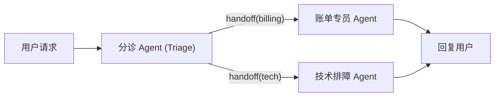

## 一句话定义

**Multi-Agent 协作** 将大任务拆分给具备不同系统提示、模型配置或工具权限的多个独立 Agent；**Supervisor** 模式由中心路由统一分配和回收控制权，**Handoff** 模式允许当前 Agent 主动把对话控制权转交给另一个专职 Agent。

## 产生背景与需要解决的问题

当单个 Agent 同时承担 30 个工具、5 套业务规范和多个相互冲突的子目标时，提示词指令之间会互相干扰。拆分为专注单元可以让每个子 Agent 拥有更干净的上下文和受限工具集。

## 第一性原理

- **职责与上下文双重隔离**：子 Agent 仅继承与其子任务相关的必要简报（Brief）与最少工具权限。
- **交接边界即契约边界**：Handoff 必须显式传递目标、约束条件与已完成状态，否则接收方会丢失前提假设。

## 核心运行机制



## 最小可行实现

```ts
export interface HandoffBrief {
  targetAgent: string;
  taskSummary: string;
  hardConstraints: string[];
  artifactPaths: string[];
}
```

## 实际应用场景

- 客服多线转接、主研发协调者将调研任务隔离委派给只读子 Agent（Context Isolation）。

## 反例与常见误区

- **反例**：为了模拟“人类公司”硬造产品经理、架构师、前端、后端、QA 五个 Agent 在群里互相打招呼闲聊，结果一句需求来回传递消耗 5 万 Token。

## 工程权衡

- **工具/上下文清晰度 vs 协调摩擦**：大多数场景优先考虑“单 Agent + 工具化子工作流”，仅在上下文确实过大或权限必须隔离时才拆分多 Agent。

## 关联知识

- 前置：[[patterns.orchestrator-workers]] · 延伸：[[multi-agent.a2a-protocol]]、[[multi-agent.cost-boundaries]]

## 事实分级与参考来源

- **已验证事实**：OpenAI Agents SDK 将 Handoff 作为一等原语实现控制权转移；LangGraph 支持 Supervisor 与 Swarm 拓扑。
