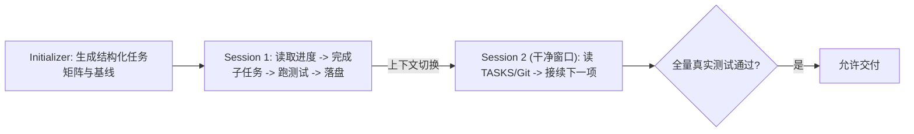

## 一句话定义

**长程会话恢复与跨窗口交接** 通过外置持久化任务列表（如 `TASKS.md` / JSON feature matrix）、Git 提交原子点与强制端到端验证门禁，让每次新开启的干净上下文会话都能无缝接力前序工作。

## 产生背景与需要解决的问题

面对需要数小时持续推进的工程构建任务，单次上下文窗口必然耗尽。Anthropic 在长程 Agent 研究中观察到两个高频失效模式：
1. 模型试图“一口气做完所有功能”，结果在上下文耗尽时留下半成品且没有记录状态。
2. 后续会话看到前面已经写了不少代码，在未跑真实端到端测试的情况下便过早宣布整个项目完成。

## 第一性原理

- **把记忆交给文件系统与 Git，而非留给对话历史**。
- **单步增量 + 端到端实测门禁**：每次增量推进一个明确子特性，只有真实测试通过后才允许把状态标为完成。

## 核心运行机制



## 最小可行实现

```json
{
  "taskId": "feat-search-fts5",
  "status": "needs_verification",
  "verifiedByCommand": null,
  "lastError": null
}
```

## 实际应用场景

- 大型多模块应用从零构建、多仓库自动化迁移。

## 反例与常见误区

- **反例**：仅靠写一段自然语言“总结我今天做了什么”交接，忽略未通过测试的精确命令输出和文件路径。

## 工程权衡

- **结构化交接文件开销 vs 返工风险**：每次迭代花几秒更新任务清单和跑局部回归测试，远胜于在错误假设上堆砌数百行代码。

## 关联知识

- 前置：[[harness.runtime-sandbox]]、[[workflow.checkpoint-durability]] · 延伸：[[coding.patch-test-review]]

## 事实分级与参考来源

- **已验证事实**：Anthropic《Effective harnesses for long-running agents》详细实证了“过早宣布完成”与“一次性贪多失效”现象及基于进度文件+端到端测试的解法。
