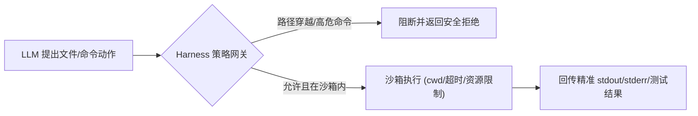

## 一句话定义

**Agent Harness（运行底座）** 是包裹在大语言模型之外的完整确定性工程壳层，负责管理上下文注入、工具执行环境、文件与命令沙箱、权限门禁、预算限制、持久化状态以及真实编译器/测试反馈闭环。

## 产生背景与需要解决的问题

工程实践与 SWE-bench 榜单反复证明：决定一个 Coding 或自动化 Agent 能否解决真实问题的，不只是模型参数本身，更取决于外围 Harness 能否提供精确的工具反馈、安全的执行边界以及防止迷失的记忆锚点。

## 第一性原理

$$\text{Agent Capability} = \text{Base Model Intelligence} \times \text{Harness Signal \& Safety Quality}$$

- 如果工具报错晦涩、沙箱没有隔离测试、或者允许模型随便写坏系统目录，再强的模型也会失败。
- 好的 Harness 把错误变成精确引导信号，同时在代码层硬性封死越权边界。

## 核心运行机制



## 最小可行实现

> 说明：以下展示节点路径安全边界验证（与本平台 `packages/content/src/security.ts` 同源原则）。

```ts
import path from 'node:path';

export function assertWithinWorkspace(workspaceRoot: string, userPath: string): string {
  if (path.isAbsolute(userPath) || userPath.includes('\0')) {
    throw new Error('Blocked: absolute path or null byte');
  }
  const resolvedBase = path.resolve(workspaceRoot);
  const resolvedTarget = path.resolve(resolvedBase, userPath);
  const rel = path.relative(resolvedBase, resolvedTarget);
  if (!rel || rel.startsWith('..') || path.isAbsolute(rel)) {
    throw new Error(`Blocked path traversal: ${userPath}`);
  }
  return resolvedTarget;
}
```

## 实际应用场景

- 本地 Coding Agent 工作区隔离、自动化测试修复环境。

## 反例与常见误区

- **反例**：为了图省事把宿主机完整 Shell 权限和管理员环境变量不加过滤直接透传给模型，一旦出现提示注入或参数幻觉即可能删除工作区外文件。

## 工程权衡

- **强隔离（容器/独立工作区） vs 本地极简轻量开发体验**：对于可信本地桌面学习工具，优先用严格工作区路径校验 + 命令白名单 + 用户审批确认，无需强制重型 Docker。

## 关联知识

- 前置：[[agent.state-environment]] · 延伸：[[harness.budget-recovery]]、[[coding.patch-test-review]]

## 事实分级与参考来源

- **已验证事实**：Anthropic《Effective harnesses for long-running agents》与 SWE-bench 研究表明外围执行环境、进度工件与验证工具显著决定最终任务解决率。
