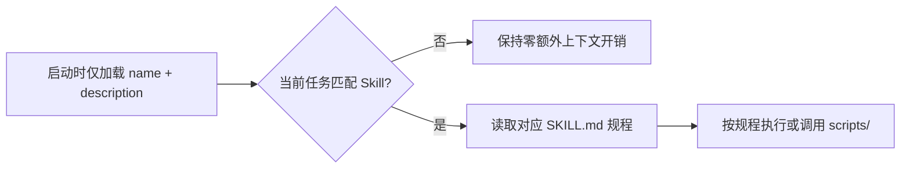

## 一句话定义

**Agent Skills** 是一种将特定领域的操作规程（`SKILL.md`）、参考资料（`references/`）与确定性辅助脚本（`scripts/`）打包为独立文件夹，并按需渐进加载到上下文中的能力扩展机制。

## 产生背景与需要解决的问题

一个工程 Agent 可能需要同时支持数据库迁移、Accessibility 审计、Figma 还原、安全规则编写等 30 种专业任务。若全部写进常驻 System Prompt，注意力将彻底崩溃；若完全靠模型临时凭记忆摸索，则容易遗漏关键步骤。

## 第一性原理

**渐进式披露（Progressive Disclosure）**：
1. **Level 1（常驻极简索引）**：初始上下文仅放入每个 Skill 的 `name` 与一句话 `description`（几十个 Token）。
2. **Level 2（触发加载）**：仅当当前用户任务匹配该 Skill 触发条件时，才读取完整 `SKILL.md`。
3. **Level 3（按需深挖）**：仅在需要执行时才读取 `references/` 子文档或运行 `scripts/` 工具。

## 核心运行机制



## 最小可行实现

```markdown
---
name: content-audit
description: Audit Markdown knowledge nodes for schema completeness, wikilink validity, and source citations.
---
# Content Audit Procedure
1. Run `pnpm validate:content` first.
2. Inspect every `MISSING_SOURCE_REF` or `BROKEN_WIKILINK` line.
```

## 实际应用场景

- 安全规则审查（如 `firestore-rules-author`）、UI 无障碍排查、自动化发版流水线。

## 反例与常见误区

- **反例**：把所有 Skill 的几万字内容直接合并拼接到全局提示里；或者把某个产品专属的目录触发方式误认为全行业唯一标准。

## 工程权衡

- **Skill vs MCP Tool**：MCP 提供可跨进程复用的动态数据与动作接口；Skill 提供“领域工作流知识与本地脚本指导”，二者常协同工作。

## 关联知识

- 前置：[[coding.repo-context-agents-md]] · 对比：[[tools.mcp-primitives]]

## 事实分级与参考来源

- **已验证事实**：渐进式上下文披露是控制系统提示膨胀的核心设计模式（Anthropic Context Engineering；Agent Skills 开放规范）。
- **争议观点**：各家 Coding Agent 宿主的目录位置与触发策略仍在演进中，工程设计时应重点复用其模块化封装理念。
