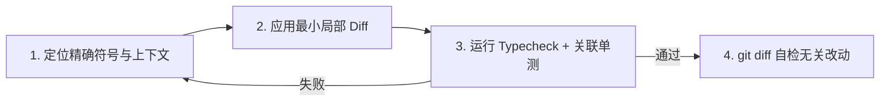

## 一句话定义

**补丁-测试-审查闭环** 是 Coding Agent 修改代码时的标准工作流：只做最小局部目标替换（Patch），随后立即运行确定性编译/类型检查/单元测试验证，并基于真实 `git diff` 审查副作用。

## 产生背景与需要解决的问题

如果让模型直接“重写整个 600 行文件”，经常出现无意删掉无关注释、改坏未触及函数或消耗大量输出 Token 的问题；同时若不强制运行真实测试，模型常常产生“看似合理但无法通过编译”的幻觉补丁。

## 第一性原理

1. **最小局部变更原则（Minimal Diff）**：精准指定目标块替换比整文件输出更省 Token、错误率更低、可审查性更强。
2. **先窄后宽验证**：先跑与改动直接相关的单测与 `tsc --noEmit`（几秒内反馈），全部通过后再跑端到端构建与 E2E 测试。

## 核心运行机制



## 最小可行实现

```ts
export function applyExactPatch(source: string, target: string, replacement: string): string {
  const idx = source.indexOf(target);
  if (idx === -1) throw new Error('Patch target not found: aborting without partial corruption');
  if (source.indexOf(target, idx + 1) !== -1) throw new Error('Ambiguous patch target: multiple occurrences');
  return source.slice(0, idx) + replacement + source.slice(idx + target.length);
}
```

## 实际应用场景

- 自动修复 Bug、新增端到端回归测试、跨文件重构接口签名（参见 [[case.code-review-pipeline]]）。

## 反例与常见误区

- **反例**：遇到测试失败时，模型为了“让测试变绿”去把断言删掉、把测试跳过（`.skip`）或放宽校验条件。Harness 与审查规程必须明确禁止此类行为。

## 工程权衡

- **自动提交 vs 人类 Diff 审查**：在生产仓库中，Coding Agent 产出应当是经过全套验证的干净工作区或 PR，而不是跳过审查直接强推主分支。

## 关联知识

- 前置：[[coding.repo-context-agents-md]]、[[harness.runtime-sandbox]] · 延伸：[[patterns.evaluator-optimizer]]

## 事实分级与参考来源

- **已验证事实**：SWE-bench（Jimenez et al., ICLR 2024）以真实 GitHub Issue 的测试补丁（FAIL_TO_PASS & PASS_TO_PASS）作为客观验证标准；强制局部 Diff 与真实测试执行大幅提升补丁可靠度。
