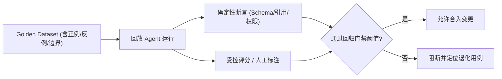

## 一句话定义

**Agent Evals（系统化评估）** 是在修改 Prompt、工具 Schema、检索策略或更换底座模型时，基于有代表性的测试用例集（Golden Dataset）自动量化准确率、工具调用正确性、延迟与成本的工程回归体系。

## 产生背景与需要解决的问题

传统的“改完 Prompt 手动试两条例子看看还行”被称为 Vibes-based Evaluation（凭感觉评估）。由于 Agent 的概率性质与多步耦合，局部提示微调极易在另外 20% 边界用例上引发隐蔽退化。

## 第一性原理

- **结果 + 轨迹双维评估**：不仅看最终答案对不对，还要看是否调用了正确工具、参数是否合法、步数是否超支、未找到证据时是否诚实拒答。
- **确定性断言优先于模型打分**：Schema 合法性、真实引用 ID 存在性、禁止越权工具调用等均可由代码 100% 确定性断言。
- **Pass@k vs Pass^k**：`Pass@k` 衡量 $k$ 次里至少成功 1 次的能力上限；`Pass^k` 衡量连续 $k$ 次都成功的生产稳定性。

## 核心运行机制



## 最小可行实现

> 可在 Playground `evals` 实验中运行评估门禁并观察 Judge 漂移导致拦截的效果。

```ts
export interface EvalCase {
  id: string;
  input: string;
  expectedTools: string[];
  mustNotInclude: string[];
}

export function evaluateDeterministicCase(
  evalCase: EvalCase,
  actualTools: string[],
  outputText: string,
): { pass: boolean; reasons: string[] } {
  const reasons: string[] = [];
  for (const t of evalCase.expectedTools) {
    if (!actualTools.includes(t)) reasons.push(`Missing expected tool: ${t}`);
  }
  for (const bad of evalCase.mustNotInclude) {
    if (outputText.includes(bad)) reasons.push(`Forbidden output substring: ${bad}`);
  }
  return { pass: reasons.length === 0, reasons };
}
```

## 实际应用场景

- 每次升级底座模型前跑 50 条代表性业务回归；Promptfoo CI 流水线阻断退化提交。

## 反例与常见误区

- **反例**：只放 100 条最简单的“Happy Path”正例，没有收集真实线上失败 case（如空检索、超时、越权诱导），导致测试集永远 99% 通过但线上频频翻车。

## 工程权衡

- **测试集规模 vs 迭代速度**：维护分层评估集——15–20 条快回归集（每次编辑跑）+ 100+ 条全量基准集（发版前跑）。

## 关联知识

- 前置：[[agent.loop]]、[[llm.sampling-decoding]] · 延伸：[[evals.tracing-observability]]、[[evals.llm-as-judge-limits]]

## 事实分级与参考来源

- **已验证事实**：Promptfoo 提倡确定性断言与模型评分结合的本地回归门禁；SWE-bench 等研究广泛采用 Pass@k 刻画随机求解表现。
