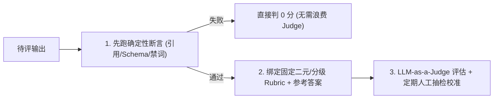

## 一句话定义

**LLM-as-a-Judge** 是利用能力较强的大模型依据预先编写的评分准则（Rubric），对难以用精确字符串匹配的开放式生成结果自动打分或做成对比较（Pairwise Comparison）的评估技术。

## 产生背景与需要解决的问题

对于总结质量、解释清晰度或架构选型理由是否充分这类开放问题，人工逐条打分在敏捷迭代中成本过高；而传统的 BLEU/ROUGE 字面重叠指标与人类工程判断相关性极差。

## 第一性原理

模型裁判的本质仍然是概率自回归推理，而非客观测量仪表，因此必然存在四类系统性偏差：
1. **冗长偏见（Verbosity Bias）**：偏爱篇幅更长、排版看似更丰满的答案，哪怕其中包含废话。
2. **位置偏见（Position Bias）**：成对比较 A vs B 时偏爱排在前面（或后面）的候选。
3. **自我偏好（Self-Enhancement Bias）**：同系列模型往往给同家族模型生成的文风打高分。
4. **评分漂移（Judge Drift）**：裁判模型版本默默更新或 Rubric 含糊时，历史基线分数失去可比性。

## 核心运行机制



## 最小可行实现

```ts
export interface JudgeRubricItem {
  criterion: string;
  passCondition: string;
  weight: number;
}
// 最佳实践：优先拆解为“是否包含明确反例 [Yes/No]”等二元问题，而非笼统打 1-10 分
```

## 实际应用场景

- 对比两版系统提示在架构说明清晰度上的相对改进（需配合交换位置 A/B 双盲测试消除位置偏见）。

## 反例与常见误区

- **反例**：把开放题的 AI 评分直接当作客观真值（Ground Truth），甚至拿未经人工校准的裁判分数去训练或自动覆盖正式知识库。

## 工程权衡

- **二元 Checklist 判别 vs 连续 1–10 打分**：多个具体的“是/否”细项核对，一致性显著高于模糊的 1–10 综合打分。

## 关联知识

- 前置：[[evals.datasets-metrics]] · 延伸：[[patterns.evaluator-optimizer]]

## 事实分级与参考来源

- **已验证事实**：Promptfoo 等评估实践表明，固定 Rubric、二元拆解、交换顺序去位置偏见与人工校准样本是缓解 Judge 偏差的必要措施。
