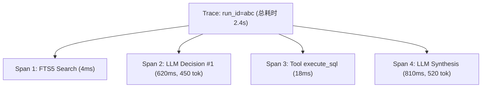

## 一句话定义

**Agent 可观测性（Observability）** 是将一次端到端请求内部的规划、多轮 LLM 调用、工具入参/出参、延迟、Token 消耗及错误状态记录为结构化 **Trace / Span 树** 的工程基础设施。

## 产生背景与需要解决的问题

传统 Web 后端报错能直接看到明确的函数调用栈；而 Agent 失败往往表现为“模型第 4 步误解了第 2 步工具返回的一段截断 JSON，最终给出看似合理的错误结论”。没有完整的步骤级 Trace，开发者根本无从排障。

## 第一性原理

- **Trace = 一次完整任务运行生命周期**。
- **Span = 其中一个原子操作**（一次检索、一次工具调用、一次模型 Generation），携带 `parentSpanId`、`latencyMs`、`tokenUsage` 与 `status`。
- **隐私红线（Redaction）**：Trace 中必须自动脱敏 `Authorization`、`apiKey` 与用户个人敏感凭据。

## 核心运行机制



## 最小可行实现

```ts
export interface TraceSpan {
  spanId: string;
  parentSpanId?: string;
  kind: 'llm' | 'tool' | 'retrieval';
  name: string;
  durationMs: number;
  status: 'ok' | 'error';
  attributes: Record<string, string | number | boolean>;
}
```

## 实际应用场景

- 排查慢请求瓶颈（区分延迟究竟卡在工具 I/O 还是 LLM 推理）、统计单任务 Token 成本归因、沉淀线上失败用例进 Eval 数据集。

## 反例与常见误区

- **反例**：把完整环境变量、Bearer Token 或用户未脱敏秘密直接写入 Trace 属性并上传到第三方观测平台。

## 工程权衡

- **本地轻量 JSON/SQLite Trace vs 外部全量 APM 平台**：桌面单机软件应保持零外部重型依赖（本地 SQLite/内存事件流即可完成调试），生产服务端可对接 OpenTelemetry GenAI 或自托管 Langfuse。

## 关联知识

- 前置：[[agent.loop]] · 延伸：[[evals.datasets-metrics]]、[[security.least-privilege-approval]]

## 事实分级与参考来源

- **已验证事实**：OpenTelemetry GenAI 语义约定与 Langfuse 均基于 Trace/Span 模型标准记录模型名、Token 与工具执行事件。
