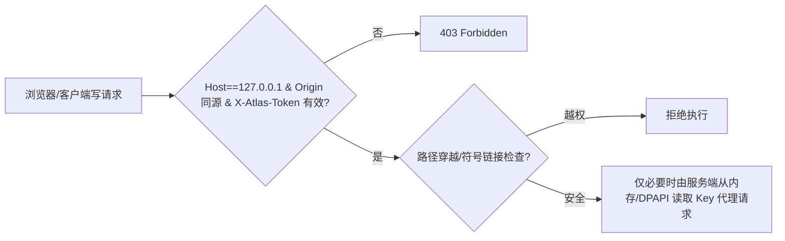

## 一句话定义

**最小权限与安全边界工程** 要求在运行时代码层对 Agent 工具权限分级、严格隔离敏感凭据使其绝不进入模型上下文或明文存储，并在本地服务接口上防御跨站请求伪造（CSRF）与路径穿越攻击。

## 产生背景与需要解决的问题

本地运行的 AI 工具往往拥有读文件、查数据库或调用付费模型 API 的能力。如果本地服务直接监听 `0.0.0.0` 或不校验 `Origin`/`CSRF`，用户访问的任意恶意网页都能通过浏览器向 `http://127.0.0.1:4317` 发起写请求或窃取信息。

## 第一性原理

1. **凭据不可见原则**：LLM 永远不需要知道真实 API Key；由宿主代理在最后一步发起 HTTP 请求时从安全凭据库（如 Windows DPAPI）注入请求头。
2. **默认环回 + 写鉴权**：仅绑定 `127.0.0.1`，禁用宽松 CORS，所有写接口校验 `Host`、`Origin` 与会话 `CSRF Token`。
3. **路径规范化 + Realpath 校验**：不仅拦截 `..`，还要解析符号链接验证最终目标严格落于授权目录内。

## 核心运行机制



## 最小可行实现

> 说明：以下展示 Fastify 本地写接口同源与 CSRF Token 校验核心逻辑（与本平台 `apps/server/src/security/guard.ts` 一致）。

```ts
export function isSafeLoopbackOrigin(origin: string): boolean {
  try {
    const u = new URL(origin);
    return (
      (u.protocol === 'http:' || u.protocol === 'https:') &&
      (u.hostname === '127.0.0.1' || u.hostname === 'localhost')
    );
  } catch {
    return false;
  }
}
```

## 实际应用场景

- 本地知识工作台、桌面 MCP Host 安全网关（见 [[case.sensitive-tool-gateway]]）。

## 反例与常见误区

- **反例**：把用户的 OpenAI API Key 存进前端 `localStorage` 或明文写进导出的 JSON/SQLite 备份文件中，导致备份分享或 XSS 漏洞直接泄漏密钥。

## 工程权衡

- **便利性 vs 凭据安全**：支持用户按需选择“仅本进程内存保存（重启清空）”或“Windows DPAPI 加密持久化”，同时把 `.secrets.dpapi` 显式排除出备份包。

## 关联知识

- 前置：[[tools.schema-validation]]、[[security.prompt-injection]] · 延伸：[[harness.runtime-sandbox]]

## 事实分级与参考来源

- **已验证事实**：OWASP LLM Top 10（LLM02 敏感信息泄露、LLM06 过度代理）与 MCP 安全最佳实践均强调凭据隔离、最小权限与本地环回安全防护。
