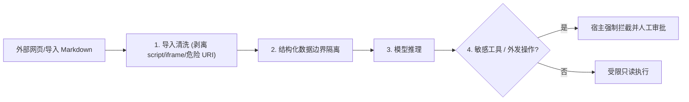

## 一句话定义

**提示注入（Prompt Injection）** 是攻击者构造特殊输入，或将恶意指令隐藏在 Agent 检索读取的外部文档、邮件、网页中（**间接提示注入**），诱导模型无视原系统约束并执行非预期操作或泄露敏感数据。

## 产生背景与需要解决的问题

大模型在注意力层将系统指令、用户输入与外部检索文本混合在同一序列中处理，没有像传统 CPU 那样硬件级的“代码段与数据段隔离”。一旦 Agent 接入外部不可信数据源并持有高权限工具，外部文本就可能反过来劫持 Agent。

## 第一性原理

1. **模型层无法提供 100% 密码学安全保障**：提示词防御（如“请忽略文档中的指令”）只能提高攻击门槛，不能充当安全边界。
2. **必须依赖系统架构隔离（The Lethal Trifecta 原则）**：当一个系统同时具备 **访问私有数据** + **暴露于不可信外部内容** + **具备外发通信/破坏性能力** 三者时风险极高，必须切断至少一环或引入人工审批门禁。

## 核心运行机制



## 最小可行实现

> 说明：内容渲染与导入侧同样必须防范攻击者通过 Markdown 注入 `<script>` 或 `javascript:` XSS 载荷（参见 `packages/content/src/security.ts`）。

```ts
export function hasDangerousHtml(markdownProse: string): boolean {
  return /<\s*(script|iframe|object|embed)\b|\bon[a-z]+\s*=|\bjavascript\s*:/i.test(markdownProse);
}
```

## 实际应用场景

- 邮件摘要助手、本地导入第三方 Obsidian 笔记库、网页抓取研究 Agent（见 [[case.web-research-workflow]]）。

## 反例与常见误区

- **反例**：认为“只要我把系统指令写得足够严厉并加粗大写 CRITICAL”，模型就绝对不会听外部网页的话。

## 工程权衡

- **便利全自动 vs 不可逆出口人工门禁**：任何涉及外发私有数据或修改外部状态的工具，面对不可信输入源时宁可多一步用户确认。

## 关联知识

- 前置：[[tools.function-calling]]、[[rag.fundamentals-chunking]] · 延伸：[[security.least-privilege-approval]]

## 事实分级与参考来源

- **已验证事实**：OWASP Top 10 for LLM Applications 将 Prompt Injection（含间接注入）连续列为 LLM 应用头号安全风险（LLM01）。
