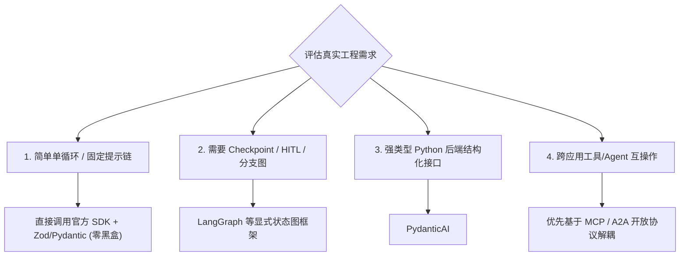

## 一句话定义

**Agent 框架选型** 应当基于控制流形态、状态持久化需求、类型安全保障、可调试透明度和团队语言栈来决策，而不是依据 GitHub Star 数或社区热度盲目堆叠抽象层。

## 产生背景与需要解决的问题

过去两年涌现了数十个 Agent 框架。不少团队尚未厘清自己的业务究竟需要简单提示链还是长程状态机，就先引入重型框架，结果发现大量时间花在绕开框架黑盒抽象、调试隐藏 Prompt 模板上。

## 第一性原理

Anthropic 工程指南指出：**很多场景下用几十行透明的直接 API 调用即可起步**；只有当系统真正需要以下能力时，框架才带来正向净收益：
1. **持久状态机与中断恢复（Checkpointing + HITL）** → 如 **LangGraph**。
2. **强类型依赖注入与结构化重试契约** → 如 **PydanticAI**。
3. **轻量级工具/Handoff 原语与内置 Trace** → 如 **OpenAI Agents SDK**、**Google ADK**。
4. **代码即动作（CodeAgent）教学/研究实验** → 如 **smolagents**。

## 核心运行机制



## 最小可行实现

> 说明：在框架快速迭代期，建议把业务知识与工具实现封装在框架无关的纯模块中（参见 [Ecosystem 技术生态对比页](/ecosystem)）。

```ts
// 依赖倒置：业务逻辑不绑定特定框架，只依赖简洁的模型调用接口
export interface ModelPort {
  complete(system: string, user: string): Promise<string>;
}
```

## 实际应用场景

- 为新立项的 AI 产品做技术选型 ADR（Architecture Decision Record）。

## 反例与常见误区

- **反例**：仅凭网上“某框架 Star 数最高”或营销 Demo 决定选型，忽略许可证条款、团队主力语言（TS vs Python）及团队是否真正需要其复杂度。

## 工程权衡

- **开箱即用脚手架 vs 长期可控性**：越封装“神奇”的框架，上线后越难定制上下文压缩与精细观测；核心控制流最好掌握在自己手中。

## 关联知识

- 前置：[[agent.taxonomy]]、[[workflow.dag-state-machine]] · 延伸：[[deployment.local-offline-ops]]

## 事实分级与参考来源

- **已验证事实**：各主流开源框架的仓库定位与 MIT/Apache-2.0 许可证均已在 `content/ecosystem/ecosystem.yaml` 核实登记（核实日期 2026-11-26）。
- **工程经验**：无论选用何种框架，将领域工具、Prompt 资产与状态持久化解耦是降低迁移成本的关键。
