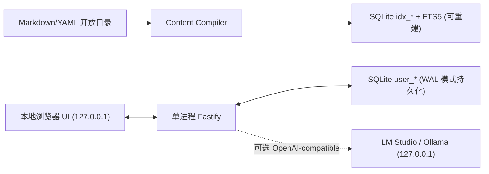

## 一句话定义

**Local-First（本地优先）工程架构** 将开放格式源文件与持久化状态保存在用户本地磁盘，使阅读、全文检索、图谱、离线实验与笔记完全独立于外部网络或云账户运行，同时通过标准协议按需接入本地推理服务（如 LM Studio / Ollama）或远端 API。

## 产生背景与需要解决的问题

依赖云端向量库、在线 SaaS 和强制登录的学习与研究工具存在三大痛点：断网即瘫痪、个人笔记被厂商锁定、平台停服导致知识资产流失。

## 第一性原理

1. **源文件开放 + 索引可重建 + 状态不可破坏**：知识资产用 Markdown/YAML 存放；全文检索与图谱表（`idx_*`）可随时删除重建；用户学习进度与笔记表（`user_*`）独立持久化并支持一致快照备份。
2. **单进程轻量运维**：本地 Web 工作台由单个 Node.js/Fastify 进程同时服务静态资源与 REST API，无需维护 Docker、Redis 或外部数据库守护进程。
3. **一致性备份**：使用 SQLite `VACUUM INTO` 生成单文件热备份快照，配合 SHA-256 `manifest.json` 校验完整性。

## 核心运行机制



## 最小可行实现

> 说明：以下 SQLite 配置与 `VACUUM INTO` 语法已在本地 Node.js 24 + SQLite 3.50.4 验证通过。

```sql
PRAGMA journal_mode = WAL;
PRAGMA foreign_keys = ON;
PRAGMA busy_timeout = 5000;
-- 生成一致性单文件备份快照（不会锁死或损坏 WAL 状态）
VACUUM INTO 'data/backups/atlas-snapshot.sqlite';
```

## 实际应用场景

- Windows 10/11 个人桌面研究工作台、内网安全隔离环境知识系统、未来封装 Tauri 2 桌面应用的底层服务架构。

## 反例与常见误区

- **反例**：在 WAL 模式下直接用普通文件复制 `atlas.sqlite` 而不带上 `-wal`/`-shm` 或不执行 `VACUUM INTO`，极易造成备份文件状态损坏。

## 工程权衡

- **纯前端 IndexedDB vs 本地 Node + SQLite**：浏览器本地存储在导入真实文件目录、Windows DPAPI 密钥隔离、跨目录备份恢复和万级中文 FTS5 性能上不如本地服务稳定可控；而通过同源单一进程启动，兼顾了零运维复杂度。

## 关联知识

- 前置：[[rag.hybrid-rerank]]、[[security.least-privilege-approval]] · 延伸：[[frameworks.landscape-selection]]

## 事实分级与参考来源

- **已验证事实**：SQLite WAL 模式与 `VACUUM INTO` 官方文档确认其可生成事务一致的独立数据库副本（SQLite 文档）；LM Studio 与 Ollama 均暴露本地 OpenAI-compatible HTTP 接口。
